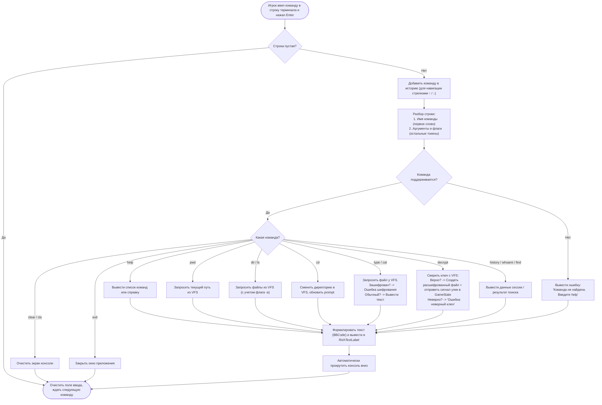
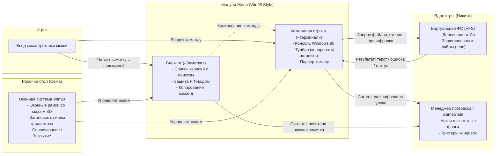

# Схемы для Технического задания (ТЗ)
## Модули: «Терминал» и «Заметки» (Зона ответственности: Женя)
### Проект: «Root Access» (Стилистика: Windows 98 Desktop GUI)

> **Примечание:** Оригиналы схем в редактируемом векторном формате находятся в файле [`Схемы_ТЗ_Терминал_и_Заметки.drawio`](file:///home/voidreign/Projects/Root_Access/doc/Схемы_ТЗ_Терминал_и_Заметки.drawio) (4 вкладки, открываются через draw.io / diagrams.net).

---

## 1. Блочная схема интерфейса «Терминал» (Стилистика Windows 98)

```text
+-------------------------------------------------------------------------------+
| [🖥️] Командная строка RootAccess - [alex@win98-pc]         [_] [ □ ] [ ✕ ]   |  <- Заголовок Win98 (сине-голубой градиент)
+-------------------------------------------------------------------------------+
|  Файл(F)    Правка(E)    Вид(V)    Терминал(T)    Справка(H)                  |  <- Менюбар Windows 98
+-------------------------------------------------------------------------------+
|  Шрифт: [ Авто / 8x12 v ]  [📋 Копировать]  [📄 Вставить]  [🧹 Очистить]      |  <- Панель инструментов (Toolbar)
+-------------------------------------------------------------------------------+
|  Microsoft(R) Windows 98                                                  [^] |  <- Клиентская область консоли
|  (C) Корпорация Microsoft 1981-1998. Подсистема RootAccess v2.4.          | |     (утопленная 3D-рамка Sunken)
|                                                                           | |     - Моноширинный шрифт (Lucida/Courier)
|  C:\MYDOCU~1\ALEX> dir                                                    | |     - Поддержка BBCode подсветки
|   Содержимое папки C:\MYDOCU~1\ALEX                                       | |
|                                                                           | |
|  [DIR]          DOCUMENTS               14.10.98  10:15                   |█|
|  [DIR]          PICTURES                14.10.98  10:16                   |█|
|  ARCHIVE  ENC            14 336         14.10.98  18:30  archive.enc      | |
|  NOTES    TXT             1 024         12.10.98  19:42  notes.txt        | |
|                 2 файлов         15 360 байт                              | |
|                 2 папок     184 320 000 байт свободно                     | |
|                                                                           | |
|  C:\MYDOCU~1\ALEX> type notes.txt                                         | |
|  "Пароль от архива спрятан в фото с дня рождения (см. свойства в Галерее)"| |
|                                                                           | |
|  C:\MYDOCU~1\ALEX> decrypt archive.enc -k 1998-10-14                      | |
|  [SUCCESS] Ключ дешифрования подтвержден!                                 | |
|  Расшифровка завершена: C:\MYDOCU~1\ALEX\ARCHIVE.TXT                      | |
|  [!] Найдена новая улика: Протокол встречи #14                            | |
|                                                                           | |
|  C:\MYDOCU~1\ALEX> decrypt [█]                                            |v|
+-------------------------------------------------------------------------------+
|  Готов к вводу | Tab - автодополнение     | C:\MYDOCU~1\ALEX    | DOS / WIN98 |  <- Статусная строка Win98
+-------------------------------------------------------------------------------+
```

---

## 2. Блочная схема интерфейса «Заметки» (Стилистика Windows 98)

```text
+-----------------------------------------------------------------------------------------------+
| [📝] Блокнот расследования - [Заметки и документы alex]                      [_] [ □ ] [ ✕ ]  |
+-----------------------------------------------------------------------------------------------+
|  Файл(F)    Правка(E)    Вид(V)    Вставка(I)    Формат(O)    Справка(H)                      |
+-----------------------------------------------------------------------------------------------+
|  [ 📄 Создать ]  [ 💾 Сохранить ]  [ 🔍 Найти ]  [ 📋 Передать команду в терминал ]          |
+---------------------------------------+-------------------------------------------------------+
|  🔍 Найти: [____________________]     |  Пароли и доступы                 [ ★ Ключевая улика ]|
+---------------------------------------+  Дата: 12 октября 1998 г., 18:30 | Автор: Александр   |
|   Имя записи                     Дата +-------------------------------------------------------+
|---------------------------------------|  Опять забыл пароль от рабочего хранилища и архива    |
| ★ Пароли и доступы            12.10.98|  ARCHIVE.ENC.                                         |
|   "Опять забыл пароль от архива..."   |                                                       |
|---------------------------------------|  Записал сюда подсказку, чтобы не потерять:           |
| 🔒 Личный дневник #42          15.10.98|  Ключ дешифрования — это дата моего дня рождения      |
|   [Заблокировано PIN-кодом]           |  в формате ГГГГ-ММ-ДД.                                |
|---------------------------------------|                                                       |
| • Список покупок и дел         08.10.98|  Если забыл точную дату — открой Галерею, найди       |
|   "Кофе, дискеты 3.5, батарейки..."   |  в папке PICTURES фото с именинным тортом со свечами  |
|---------------------------------------|  и посмотри свойства файла (метаданные даты съёмки).  |
| • Черновик письма Виктору      05.10.98|                                                       |
|   "Высылаю копию отчета..."           |  Команда для дешифровки через терминал:               |
|                                       |  +-------------------------------------------------+  |
|                                       |  | decrypt archive.enc -k <ДАТА_ГГГГ-ММ-ДД>        |  |
|                                       |  +-------------------------------------------------+  |
|                                       |                                                       |
|                                       |  [ 📋 Вставить команду в Командную строку ]           |
+---------------------------------------+-------------------------------------------------------+
|  Всего заметок: 4 | Найдено улик: 1   | Документ открыт | Строк: 14 | Windows 98 RichText     |
+---------------------------------------+-------------------------------------------------------+
```

### Модальное окно ввода PIN-кода (Windows 98 Dialog):
```text
            +---------------------------------------------+
            | 🔒  Защищенный документ                     |
            +---------------------------------------------+
            | Введите 4-значный PIN-код для доступа:      |
            |                                             |
            |                 [  • • • •  ]               |
            |                                             |
            |        [  OK  ]         [ Отмена ]          |
            +---------------------------------------------+
```

---

## 3. Блок-схема логики работы парсера команд



---

## 4. Схема взаимодействия модулей


