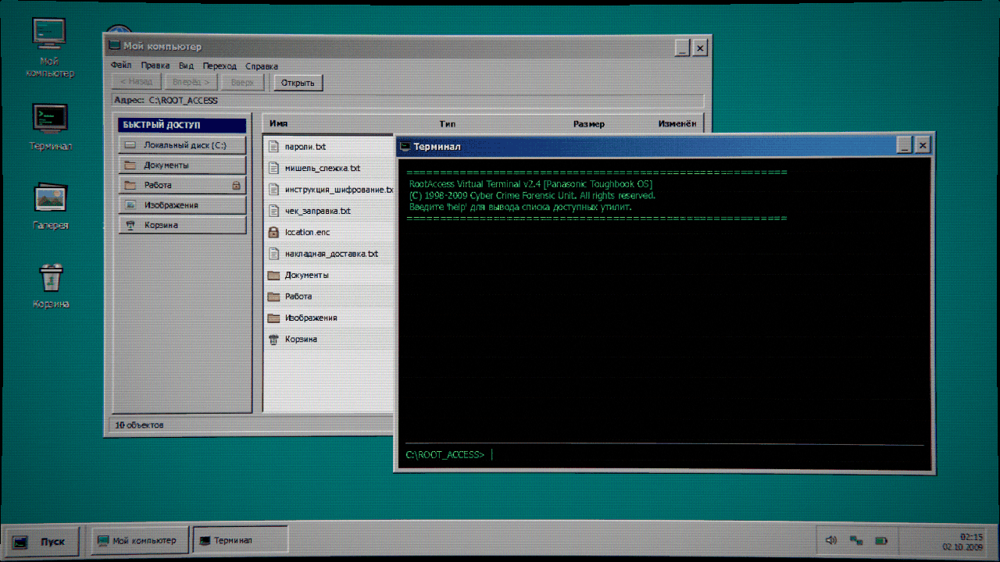

# Рабочий стол и оконная система (Issue #10)

Макет ретро-операционной системы FARA OS: бирюзовый рабочий стол, панель задач
с меню «Пуск», трей, сюжетные часы `02:15` / `02.10.2009` и универсальный
каркас окон в стиле Windows 98/2000.



## Что реализовано

- `scenes/desktop/Desktop.tscn` — рабочий стол `#008080`, сетка из семи иконок
  («Мой компьютер», «Браузер», «Терминал», «Карты», «Галерея», «Заметки»,
  «Корзина»), панель задач, кнопка «Пуск», кнопки открытых окон, трей и часы.
- `scenes/ui/WindowFrame.tscn` — переиспользуемое окно: синий градиент шапки,
  заголовок, иконка, кнопки «Свернуть» и «Закрыть», серая рельефная рамка,
  перетаскивание за шапку, ограничение положения рабочей областью.
- `scenes/apps/Browser.tscn` — ретро-браузер с адресной строкой, кнопкой
  «История» и встроенным веб-мессенджером. История и переписка читаются из
  `data/files.json`; строка «Мессенджер: Юджин Рейвенс (Брат)» открывает чат
  с плашкой «Сообщения старше 30 дней были автоматически удалены».
- Меню «Пуск» с поиском по приложениям, закрытием по `Esc` и клику вне меню.
- Интерактивный трей: громкость, сеть и батарея показывают мини-панель состояния.
- Сюжетные часы: `02:15` и `02.10.2009`; системное время не используется.
- Галерея загружает 15 реальных фото из `assets/photos` по массиву `photos`
  из `data/files.json`. Если файла нет — карточка с именем и плейсхолдером
  «НЕТ ФАЙЛА», без падения. Сетка прокручивается; в просмотрщике работают
  зум колёсиком и перетаскивание увеличенного снимка.
- «Свойства / Подробнее» в Галерее открывает EXIF-карточку; у `IMG_0488.JPG`
  дата съёмки `24.09.2009` — подсказка к паролю.
- Метки на интерактивной карте — настоящие кнопки: клик открывает карточку
  места с адресом, а для Склада № 3 доступна кнопка отправки группы захвата.
- CRT-линза: бочкообразное искажение через шейдер, скруглённые углы кинескопа,
  пикселизация, сканлайны и виньетка.
- Программный курсор рисуется внутри искажаемого кадра. `InputCatcher`
  пересчитывает клики обратным преобразованием линзы, поэтому даже маленькие
  кнопки вроде «Свернуть» не промахиваются.

## Запуск

Требуется Godot 4.x (проверено на 4.6.1, GL Compatibility).

```text
godot --path .
```

Главная сцена — `scenes/desktop/Desktop.tscn`.

## Управление

| Действие | Результат |
|---|---|
| Клик по иконке | Выделяет и открывает приложение |
| Двойной клик по иконке | Также открывает приложение (совместимость с классикой) |
| Стрелки / Enter при фокусе на иконке | Навигация по сетке / открытие |
| Перетаскивание за шапку | Свободное перемещение окна |
| `_` в шапке | Сворачивает окно в панель задач |
| Клик по кнопке на панели задач | Восстанавливает / сворачивает окно |
| `×` в шапке | Закрывает окно |
| «Пуск» | Открывает меню приложений |
| Поиск в «Пуске» | Фильтрует приложения по названию |
| Клик по трею | Показывает состояние громкости / сети / батареи |
| «Браузер» → «История» | Показывает запросы из `data/files.json` |
| Строка «Мессенджер: Юджин Рейвенс (Брат)» | Открывает чат братьев |
| «Свойства / Подробнее» в Галерее | Открывает EXIF-свойства выбранного фото |
| Колесо мыши в просмотрщике фото | Зум 100–600% |
| Перетаскивание увеличенного фото | Панорамирование снимка |
| Клик по метке на карте | Открывает карточку места с адресом |
| «Отправить группу захвата» | Подтверждает отправку группы на Склад № 3 |
| `Esc` | Закрывает меню «Пуск», панель трея и карточку |

## Структура сцены

```text
Desktop (Control)
├── Wallpaper                 #008080
├── DesktopSurface
│   ├── Icons                 GridContainer, 6 × DesktopIcon
│   └── WindowLayer           сюда добавляются WindowFrame
├── Taskbar                   панель задач 48 px
│   └── StartButton / TaskButtons / Tray / Clock
├── StartMenu                 меню «Пуск»
├── TrayPopup                 мини-панель трея
├── ShutdownDialog            заглушка завершения сеанса
├── CRTOverlay                сканлайны
├── Vignette                  виньетка
├── InputCatcher              перехват кликов и обратное CRT-преобразование
├── Cursor                    программный курсор внутри линзы
└── CRTLayer (CanvasLayer)    BackBufferCopy + CRTEffect (шейдер)
```

## Оконный каркас

`WindowFrame` — `PanelContainer` с контентной областью `ContentContainer`.
Публичный API:

```gdscript
var frame: WindowFrame = preload("res://scenes/ui/WindowFrame.tscn").instantiate()
frame.window_title = "Мой компьютер"
frame.window_icon = preload("res://assets/icons/computer.svg")
frame.min_window_size = Vector2(560, 360)
add_child(frame)
frame.embed_app(my_app_scene.instantiate())
```

Сигналы: `close_requested`, `minimize_requested`, `focus_requested`.
Свойства: `window_title`, `window_icon`, `app_scene`, `min_window_size`,
`title_active_style`, `title_inactive_style`.

Канонический путь сцены — `scenes/ui/WindowFrame.tscn`. Для совместимости с
`scenes/apps/WindowFrame.tscn` из ветки терминала оставлен алиас, который
инстансирует каноническую сцену.

## Карточки приложений

`scenes/ui/InfoCard.tscn` — модальная ретро-карточка с затемнением, заголовком,
BBCode-текстом и опциональной кнопкой действия. Используется в двух местах:

- **Галерея** — кнопка `Свойства / Подробнее` открывает свойства выбранного
  снимка. Для `IMG_0488.JPG` показана дата `24.09.2009` — подсказка к паролю.
  Клик по другой карточке меняет выбранное фото и его метаданные.
- **Карты** — каждая метка является `Button`; клик открывает карточку места.
  `Адрес Мишель` показывает `Address: LENINA 54`, а `Склад № 3` — карточку
  штурма с кнопкой `[ Отправить группу захвата ]` и подтверждением отправки.

## Браузер и веб-мессенджер

`scenes/apps/Browser.tscn` + `scripts/apps/browser.gd`:

- адресная строка, кнопки «Назад», «Главная», «Перейти», «История»;
- вкладка истории с записями из `data/files.json` (бытовые, смешные и
  криминальные запросы) и заглушкой «Архив за прошлые периоды повреждён»;
- строка `Мессенджер: Юджин Рейвенс (Брат)` открывает встроенный чат;
- в чате сверху плашка «Сообщения старше 30 дней были автоматически удалены
  пользователем», далее сообщения Саймона и Юджина с датами;
- остальные записи истории показывают заглушку повреждённого локального кэша.

## Галерея

- 15 фотографий загружаются из массива `photos` в `data/files.json` по
  `res://assets/photos/<filename>`; при отсутствии файла показывается
  плейсхолдер с именем, игра не падает.
- Сетка миниатюр 3 колонки в `ScrollContainer` (помещаются 12–15 фото).
- Двойной клик открывает просмотрщик; колесо мыши меняет зум от 100% до 600%,
  перетаскивание панорамирует увеличенный снимок.
- «Свойства / Подробнее» показывает имя файла, камеру, разрешение, размер и
  дату съёмки; для `IMG_0488.JPG` — `24.09.2009`.

## CRT-линза и синхронизация мыши

- Шейдер: `shaders/crt_lens.gdshader` — обратное бочкообразное искажение,
  скруглённые углы, пикселизация, сканлайны, виньетка и лёгкие аналоговые
  помехи. Работает как пост-обработка `screen_texture`; перед оверлеем стоит
  `BackBufferCopy`.
- Курсор: `scripts/desktop/crt_cursor.gd` — программная стрелка внутри
  искажаемого кадра, а не системный курсор. Системный курсор скрывается.
- Ввод: `scripts/desktop/crt_input_catcher.gd` перехватывает сырые клики,
  `Desktop.handle_crt_gui_input()` переводит экранную позицию в координаты
  интерфейса через `crt_screen_to_ui()` и отправляет уже исправленное событие
  в GUI. Поэтому маленькие кнопки (20×18) не промахиваются даже на краях линзы.
- Обратное преобразование `crt_ui_to_screen()` используется тестами и проверкой
  позиции курсора: визуальная стрелка и хитбоксы остаются в одной точке.
- Отключить эффект можно через `Desktop.crt_enabled = false` (системный курсор
  возвращается, ввод работает без искажения).

## Сюжетное время

Часы не читают системное время: стартовое значение задано сценарием
(`02:15`, `02.10.2009`). Для интеграции с сюжетом предусмотрены методы:

```gdscript
var desktop: Desktop = get_tree().current_scene
desktop.set_story_time(2, 15)       # точное значение
desktop.advance_story_time(85)      # 02:15 → 03:40 после дешифровки
desktop.story_time_changed.connect(func(h, m): print(h, ":", m))
```

## Проверки

Headless-тест каркаса:

```text
godot --headless --path . --scene res://tests/test_desktop_shell.tscn
```

Проверяет семь иконок, часы, открытие всех семи приложений (включая Браузер),
кнопки панели задач, сворачивание/восстановление, закрытие, перемотку времени,
поиск, карточку «Свойства / Подробнее» с датой `24.09.2009`, карточки карты
(`LENINA 54`, штурм Склада № 3), загрузку 15 реальных фото, зум и
перетаскивание фото, историю Браузера с переходом в чат Юджина и обратимость
CRT-преобразования мыши.

Интерактивный тест реальных кликов и перетаскивания (нужно окно):

```text
godot --path . --scene res://tools/test_interactions.tscn
```

Результат на текущей сборке: `INTERACTIONS: PASS` — одиночный клик открывает
окно, перетаскивание даёт ожидаемый сдвиг, «Свернуть»/восстановление/«Закрыть»
работают, метка карты, «Свойства / Подробнее», зум/панорама фото и переход
«История → чат Юджина» кликаются через CRT-линзу, курсор визуально совпадает
с реальной мышью.

## Definition of Done

| Пункт | Статус |
|---|---|
| Сцена рабочего стола и панели задач | ✅ `Desktop.tscn`, панель 48 px, «Пуск», трей |
| Часы показывают сюжетное ночное время | ✅ `02:15`, дата `02.10.2009` |
| Окна открываются по клику на иконку и закрываются крестиком | ✅ проверено интерактивным тестом |
| Окна свободно перетаскиваются по рабочему столу | ✅ заголовок — drag-зона, есть ограничение видимости |
| «Свойства / Подробнее» показывает дату съёмки | ✅ `24.09.2009`, карточка выбранного фото |
| Метки карты кликабельны | ✅ карточки адресов и штурма Склада № 3 |
| Браузер открывает историю и чат с Юджином | ✅ `Browser.tscn`, данные из `files.json` |
| Галерея грузит реальные фото, зумирует и панорамирует | ✅ 15 фото, `ScrollContainer`, 100–600% |
| CRT-линза синхронизирована с мышью | ✅ InputCatcher + обратное преобразование + курсор внутри кадра |

## Скриншоты

| Приложение | Скриншот |
|---|---|
| Рабочий стол | [desktop_mockup.png](screenshots/desktop_mockup.png) |
| Мой компьютер | [app_computer.png](screenshots/app_computer.png) |
| Браузер | [app_browser.png](screenshots/app_browser.png) |
| История браузера | [browser_history.png](screenshots/browser_history.png) |
| Чат с Юджином | [browser_messenger.png](screenshots/browser_messenger.png) |
| Терминал | [app_terminal.png](screenshots/app_terminal.png) |
| Карты | [app_maps.png](screenshots/app_maps.png) |
| Карточка «Адрес Мишель» | [map_card_michelle.png](screenshots/map_card_michelle.png) |
| Карточка «Склад № 3» | [map_card_warehouse.png](screenshots/map_card_warehouse.png) |
| Подтверждение штурма | [map_card_capture.png](screenshots/map_card_capture.png) |
| Галерея | [app_gallery.png](screenshots/app_gallery.png) |
| Свойства фото | [gallery_properties.png](screenshots/gallery_properties.png) |
| Просмотрщик с зумом | [gallery_viewer.png](screenshots/gallery_viewer.png) |
| Заметки | [app_notes.png](screenshots/app_notes.png) |
| Корзина | [app_recycle.png](screenshots/app_recycle.png) |
| Меню «Пуск» | [start_menu.png](screenshots/start_menu.png) |
| CRT-курсор | [crt_cursor.png](screenshots/crt_cursor.png) |

## Ограничения макета

- Проводник, Терминал, Заметки, Браузер и Галерея — рабочие сцены. Карты пока
  используют интерактивный `MapPreview`; полноценный игровой слой карты
  подключается отдельной задачей.
- Внешней сети нет: Браузер показывает только локальную историю и сохранённый
  чат из `data/files.json`; кнопка «Перейти» и остальные записи истории ведут
  на заглушку локального кэша.
- Карточки карты и штурма — UI-макет: в финальном таймере кнопка вызывает
  `GameState.trigger_ending()`, вне финала она скрыта.
- CRT-эффект использует screen texture и BackBufferCopy. На слабых GPU его можно
  выключить: `Desktop.crt_enabled = false`; системный курсор при этом
  возвращается, а координаты кликов перестают искажаться.
- В CRT-режиме системный курсор скрыт, вместо него рисуется программная стрелка
  внутри кадра. `InputCatcher` пересчитывает клики, поэтому даже кнопки 20×18
  в шапке окна остаются кликабельными.
- По Issue #10 одиночный клик сразу открывает приложение. Для соответствия
  пункту SRS OS-13 («одиночный клик — выделение, двойной — открытие») у
  `Desktop` есть экспорт `single_click_to_open`; установите его в `false`.
- Размеры элементов ориентированы на Win98-стиль задачи (шапка 27 px, панель
  48 px), а не на более позднюю modern-сетку из SRS.
- Шрифт — системный Tahoma с fallback на MS Sans Serif / Segoe UI / Arial;
  на Linux/macOS внешний вид может немного отличаться.

## Генерация ассетов

Все 9-patch текстуры, градиенты, виньетка и placeholder-фотографии
детерминированно генерируются скриптом:

```text
python tools/generate_ui_assets.py
```

Нужен Pillow. Скрипт не обязателен для запуска игры: готовые PNG уже лежат в
`assets/ui` и `assets/previews`.
