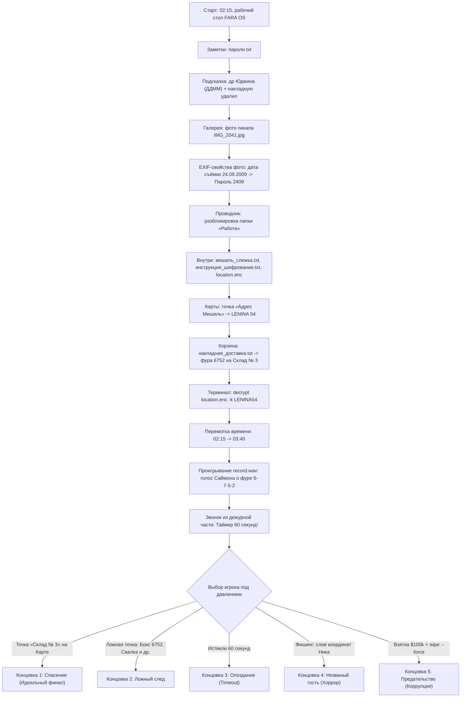

# Root Access: Полная документация проекта (От А до Я)

> **Жанр:** Психологический детективный триллер в стилистике ретро-ОС (Windows 98 / 2000).  
> **Движок:** Godot 4.x (GDScript) | **Платформа:** PC (Linux / Windows)  
> **Временной срез игры:** Глубокая ночь, **02.10.2009**, стартовое время: **02:15**.  
> **Главный объект:** Защищённый армейский ноутбук Panasonic Toughbook, изъятый у серийного похитителя Саймона Раклина.

---

## 1. Сюжет и действующие лица

### 1.1. Завязка истории
Детектив-криминалист департамента полиции **Ник Будхайм** находится один на ночном дежурстве в своей тёмной квартире. За окном дождь и пустой город. Несколько часов назад оперативники задержали подозреваемого в серии похищений — **Саймона Раклина**. 

При обыске изъят старый защищённый армейский ноутбук с кастомной легковесной ретро-ОС без сетевой телеметрии. Похищена студентка **Мишель Юхнова**, счёт идёт на минуты. Задача детектива — взломать ноутбук, изучить файловую систему, расшифровать криптоконтейнеры, восстановить улики из корзины и отправить группу захвата в точное логово маньяка до истечения времени.

### 1.2. Действующие лица и прототипы
| Персонаж | Роль в сюжете | Прототип в команде разработки |
| :--- | :--- | :--- |
| 🕵️‍♂️ **Ник Будхайм (Nick Budheim)** | Детектив-криминалист, протагонист, сидящий за ноутбуком | Никита Буд-Гусаим (Team Lead) |
| 🔪 **Саймон Раклин (Simon Rakhlin)** | Серийный похититель, удерживающий заложницу, владелец ноутбука | Семён Рахлин (UI/UX Designer) |
| 📦 **Юджин Рейвенс (Eugene Ravens)** | Младший брат Саймона, скрытый сообщник, арендовавший фургон | Евгений Ревенко (CLI & Logic Dev) |
| 🎯 **Мишель Юхнова (Michelle Yukhnova)** | Похищенная студентка, заложница | Михаил Юхнович (QA & Scenario) |

---

## 2. Пошаговый сценарий расследования (Акты 1–4)



### Акт 1. Поиск пароля от папки «Работа»
1. Ник запускает приложение **«Заметки»** и открывает записку `пароли.txt`. В тексте указано:
   > *«Пароль от папки Работа — др Юджина (день и месяц, 4 цифры: ДДММ). Накладную удалил, надо бы потом очистить корзину...»*
2. В браузере / галерее игрок находит снимок у ржавого пикапа (`IMG_2041.jpg`).
3. При нажатии кнопки **«Свойства / Подробнее»** в окне свойств отображается дата съёмки: **`24.09.2009`**.
4. Каноничный пароль для папки — **`2409`** (валидатор прощает `24.09`, `24/09`, `24092009`).

### Акт 2. Взлом папки «Работа» и дешифровка через Карты
1. В **«Проводнике»** игрок кликает по заблокированной папке `Работа`, вводит пароль `2409`. Папка разблокируется.
2. Внутри находятся:
   * `мишель_слежка.txt` — расписание маршрута студентки;
   * `инструкция_шифрование.txt` — синтаксис дешифровки: `decrypt <file> -k <key>`, ключ — адрес латиницей без пробелов;
   * `location.enc` — зашифрованный контейнер.
3. В приложении **«Карты»** игрок открывает метку **«Адрес Мишель»** и находит карточку: `Address: LENINA 54`. Ключ дешифровки — **`LENINA54`** (поддерживаются варианты `lenina54`, `lenina 54`).
4. В **«Корзине»** игрок открывает удалённый документ `накладная_доставка.txt`:
   > *«Аренда грузового фургона (бортовой номер 6752). Арендатор: Е. Рейвенс. Выгрузка оборудования: Склад № 3 (Северная промзона)».*
5. В **«Терминале»** вводится команда:
   `decrypt location.enc -k LENINA54`
   Отображается псевдографический прогресс-бар: `[████████████████] 100% COMPLETE`.
6. Стрелки часов на панели задач динамически перематываются с **`02:15` на `03:40`**.

### Акт 3. Аудиозапись record.wav и таймер 60 секунд
1. Расшифрованный аудиофайл `record.wav` разблокируется в папке `Работа`.
2. При открытии запускается аудиоплеер с визуализацией и механическим голосом Саймона:
   > *«...время почти вышло. Грузовик 6-7-5-2... Она останется здесь навсегда...»*
3. Раздаётся звонок дежурного: напарник сообщает, что Саймон вышел на связь и убьёт заложницу через 10 минут. На дорогу спецназу требуется 9 минут — **у Ника ровно 60 секунд, чтобы подтвердить координаты штурма на карте**.
4. Включается **реальный таймер 60 секунд**, плашка таймера фиксируется сверху, окно мыслей адаптируется и не перекрывает Карту.

### Акт 4. Психологические ловушки и концовки
* **Ловушка внимания на карте:** Точка «Бокс № 6752» кажется очевидной из-за цифр из аудиозаписи. Но истинное логово — **«Склад № 3»**, куда фура с номером 6752 доставила груз по накладной.
* **Искушение взяткой ($100,000):** На 30-й секунде вылетает окно от Саймона с предложением $100k и одновременным автооткрытием терминала для ввода `wipe --force`. Кнопка «Отмена» обведена красным.
* **Фишинг-ловушка:** Через 5 секунд после отмены взятки вылетает диалог проверки сети, где красным коварно подсвечена кнопка «Продолжить» (слив домашнего адреса Ника).
* **Приоритет 00:00:** Таймер имеет абсолютный приоритет над любыми открытыми окнами.

---

## 3. Все концовки игры

| ID | Название | Условие получения | Описание финала |
| :-: | :--- | :--- | :--- |
| **1** | 🟢 **Спасение (Salvation)** | Выбрана точка «Склад № 3» на Карте и подтверждён штурм | Спецназ штурмует Склад № 3 за минуту до расправы. Мишель спасена, Саймон обезврежен, Юджин взят на выезде из города. Идеальная победа. |
| **2** | 🟡 **Ложный след (False Trail)** | Выбрана неверная точка («Бокс № 6752», «Свалка», «Гаражи» и др.) | Группа захвата штурмует пустой гараж. Время упущено, Саймон скрывается, заложница не спасена. |
| **3** | 🔴 **Опоздание (Timeout)** | Истекли 60 секунд финального таймера (00:00) | Ник не успел передать координаты. Связь обрывается короткими гудками. Звучит сирена. Заложница погибла. |
| **4** | 💀 **Незваный гость (Horror)** | Подтверждена отправка данных в фишинговом окне | Юджин перехватывает координаты квартиры Ника. Шаги на лестничной клетке, выстрел через дверь. Ник погибает в своей квартире. |
| **5** | 💰 **Предательство (Corruption)** | Введена команда `wipe --force` после взятки Саймона | Все улики уничтожены, ноутбук очищен. Ник забирает деньги из ячейки и увольняется. Дело закрыто как нераскрытое. |

---

## 4. Архитектура программной системы

```
Root_Access/
├── assets/                  # Графические ассеты, ретро-иконки, фото, портреты
│   ├── icons/               # 15+ векторных SVG иконок Win98 (компьютер, папки, диск...)
│   ├── photos/              # 15 сюжетных фотографий расследования (IMG_0385..IMG_0512)
│   ├── portraits/           # Портреты персонажей (Саймон, Юджин, Мишель)
│   ├── ui/                  # 9-patch текстуры кнопок, рамок, заголовков, курсор
│   └── theme/               # Ретро-тема retro_theme.tres
├── scenes/
│   ├── desktop/
│   │   └── Desktop.tscn     # Главная сцена рабочего стола, панель задач, часы
│   ├── apps/
│   │   ├── Terminal.tscn    # Моноширинная консоль DOS/Win98
│   │   ├── Notes.tscn       # Текстовый процессор (список + просмотр)
│   │   ├── Explorer.tscn    # Проводник («Мой компьютер» и «Корзина»)
│   │   └── WindowFrame.tscn # Универсальное перетаскиваемое окно Win98
│   └── ui/
│       ├── ThoughtBox.tscn  # Окно мыслей героя (новелла-стиль)
│       ├── FinalTimerBar.tscn # Верхний таймер 60 секунд
│       ├── InfoCard.tscn    # Карточки точек на карте
│       └── ToastBanner.tscn # Системные подсказки
├── scripts/
│   ├── core/
│   │   ├── GameState.gd     # Глобальный менеджер расследования (AutoLoad)
│   │   └── VFS.gd           # Виртуальная файловая система (AutoLoad)
│   ├── apps/
│   │   ├── terminal.gd      # Командный процессор CLI
│   │   ├── notes.gd         # Логика заметок
│   │   └── explorer.gd      # Логика файлов, навигации и пароля
│   ├── desktop/
│   │   ├── desktop.gd       # Менеджер рабочего стола и окон
│   │   └── crt_cursor.gd    # Синхронизация курсора в ЭЛТ-линзе
│   └── ui/
├── shaders/
│   └── crt_lens.gdshader    # Бочкообразный шейдер выпуклого кинескопа ЭЛТ
└── tests/                   # Набор автоматических тестов
    ├── test_terminal.tscn
    ├── test_desktop_shell.tscn
    ├── test_notes_and_explorer.tscn
    └── test_narrative_core.tscn
```

### 4.1. Ключевые AutoLoads (Синглтоны)
1. **`GameState` (`scripts/core/GameState.gd`)**:
   - Управляет сюжетными флагами (`is_notes_opened`, `is_work_folder_unlocked`, `is_location_decrypted`, `is_trash_inspected`).
   - Валидирует пароль папки «Работа» (`verify_work_password()`).
   - Контролирует 60-секундный таймер (`start_final_timer()`, `time_remaining`).
   - Управляет показом мыслей Ника (`trigger_thought()`), взятки и фишинга.
   - Фиксирует концовку (`trigger_ending()`).
2. **`VFS` (`scripts/core/VFS.gd`)**:
   - Единая точка доступа к виртуальным файлам: `list_dir(path)`, `read_file(path)`, `decrypt_file(path, key)`.
   - Изолирует файловую структуру от реального диска операционной системы.

---

## 5. Распределение ролей в команде

| Разработчик | Профиль GitHub | Зона ответственности |
| :--- | :--- | :--- |
| **Никита (nikkey31)** | Team Lead | Архитектура ядра (`GameState`, VFS), сюжетная линия, система таймера и мыслей, слияние веток в `dev`. |
| **Сёма (sema)** | UI/UX & Graphics | Графика и стилистика Win98, окна `WindowFrame`, шейдер выпуклой CRT-линзы, интерактивные Карты, Галерея и EXIF-свойства фото. |
| **Женя (Vo1dReign)** | CLI & Logic Developer | Встроенный Терминал, командный процессор (`help`, `clear`, `ls`, `cat`, `cd`, `pwd`, `decrypt`, `wipe`), приложение «Заметки», Проводник и Корзина, аудиопроигрыватель `record.wav`. |
| **Миша (yukhnov)** | QA & Scenario | Документация (SRS, ТЗ), контент загадок и накладных, тестирование сценариев и приёмка фич. |

---

## 6. Запуск и тестирование проекта

### Запуск игры
```bash
cd ~/Projects/Root_Access
godot scenes/desktop/Desktop.tscn
```

### Headless автотесты (без графики)
```bash
# 1. Тест Терминала
godot --headless --path . --scene res://tests/test_terminal.tscn

# 2. Тест Рабочего стола и Оконного менеджера
godot --headless --path . --scene res://tests/test_desktop_shell.tscn

# 3. Тест Заметок, Проводника, Корзины и пароля
godot --headless --path . --scene res://tests/test_notes_and_explorer.tscn

# 4. Тест Нарративного ядра, мыслей, таймера и концовок
godot --headless --path . --scene res://tests/test_narrative_core.tscn
```
