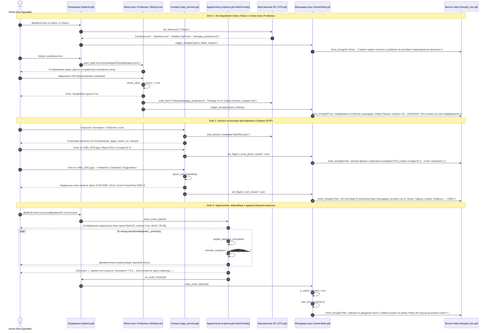
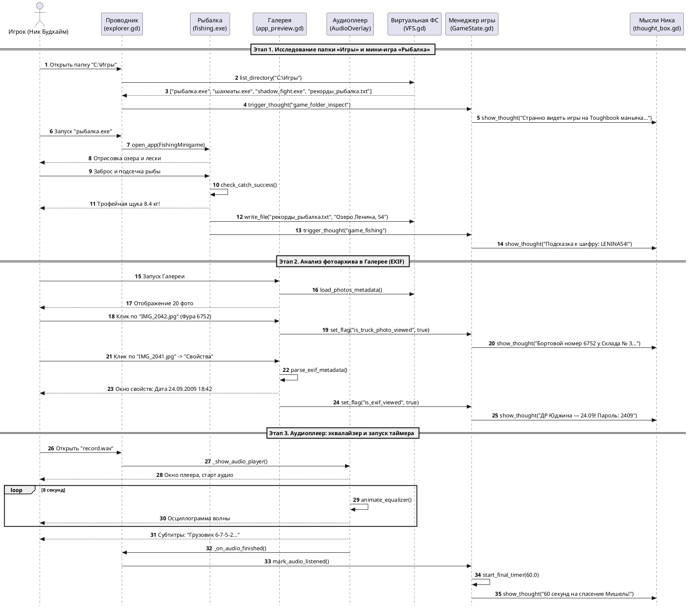
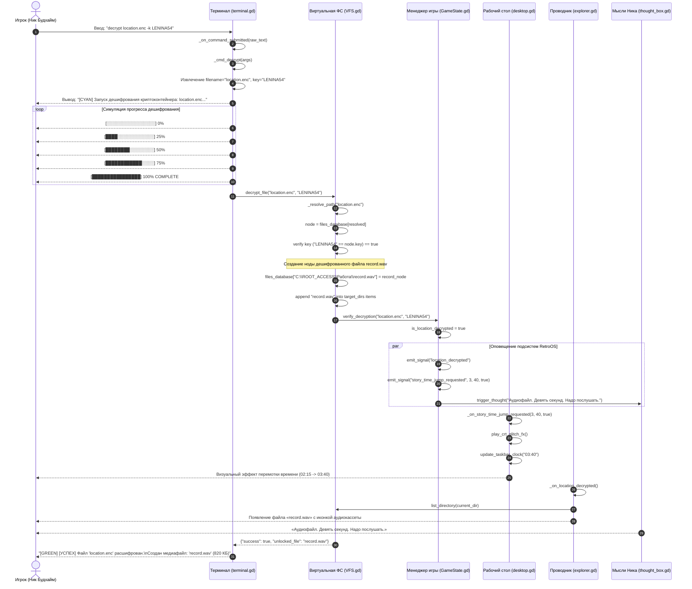
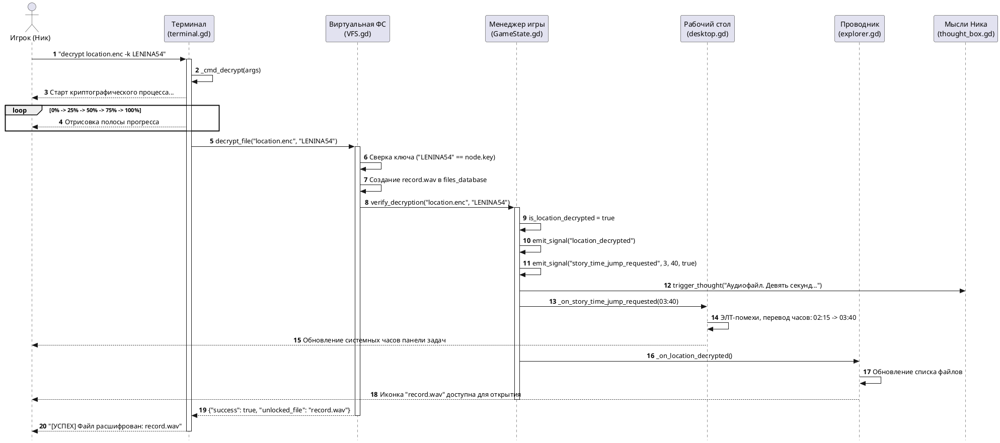
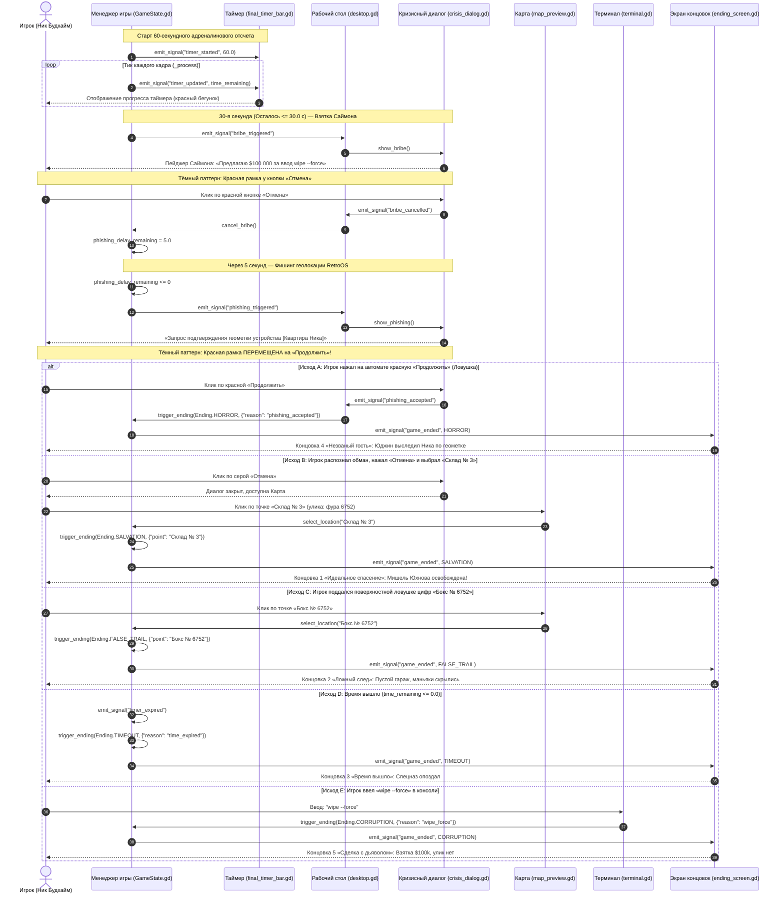
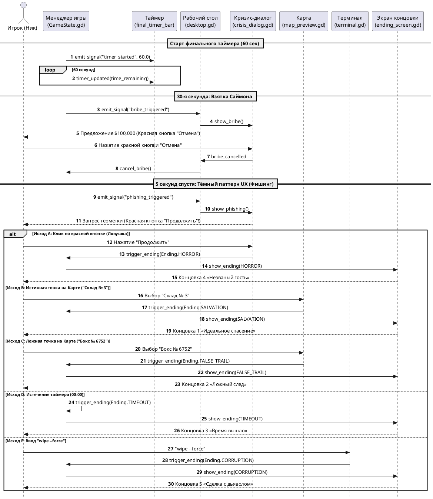

# UML-диаграммы последовательности (Sequence Diagrams) — «Root Access»

**Дисциплина:** Технологии разработки программного обеспечения (ТРПО)  
**Проект:** Детективный психологический ретро-симулятор «Root Access»  
**Артефакт:** UML Sequence Diagrams (Практическая работа № 4)  
**Автор:** Миша (`uhmaikl-cell`), документовед и QA команды  
**Статус:** Согласовано с архитектурой ядра (Godot 4.x / GDScript)

---

## 1. Введение и архитектурный контекст

Настоящий документ содержит спецификацию и визуальные UML-диаграммы последовательности (**Sequence Diagrams**) для ключевых сценариев взаимодействия игрока и подсистем виртуальной операционной системы Toughbook RetroOS 98 в рамках 4-й практической работы:

1. **Сценарий 1. Исследование медиа-улик и прохождение мини-игр:**
   - Папка `C:\Игры` $\rightarrow$ мини-игра «Рыбалка» (извлечение фрагмента ключа шифрования);
   - Приложение «Галерея» $\rightarrow$ просмотр экспозиции фотоархива и вызов окна EXIF-метаданных даты съемки;
   - Модальный «Аудиоплеер» $\rightarrow$ динамический эквалайзер/осциллограмма, субтитры и воспроизведение записи `record.wav`.
2. **Сценарий 2. Цепочка дешифрования криптоконтейнера `location.enc`:**
   - Ввод консольной команды `decrypt <файл> -k <ключ>` в приложении `Terminal`;
   - Парсинг флагов и аргументов командной строки;
   - Верификация контрольной суммы и ключа в `VFS` и `GameState`;
   - Генерация дешифрованного файла `record.wav`;
   - Синхронная перемотка системного времени с `02:15` на `03:40` и реакция интерфейса рабочего стола.
3. **Сценарий 3. Кризисный финал расследования (Таймер 60 секунд, Dark UX ловушки и 5 концовок):**
   - Запуск 60-секундного адреналинового таймера после окончания аудиозаписи;
   - Перехват сокета Саймона на 30-й секунде (предложение взятки $100,000, приучение к красной кнопке отмены);
   - Психологическая фишинг-ловушка через 5 секунд (провокация клика по красной кнопке продолжения);
   - Ветвление на 5 сюжетных концовок (`EndingScreen`).

Каждая диаграмма представлена в двух стандартах:
- **Mermaid (`sequenceDiagram`)** — для интерактивного отображения в веб-интерфейсе GitHub, VS Code и Godot IDE;
- **PlantUML (`@startuml ... @enduml`)** — для вставки векторных схем в официальный отчёт `ТРПОПР4.docx`.

---

## 2. Диаграмма 1. Исследование медиа-улик и прохождение мини-игр

### 2.1. Описание сценария
Детектив Ник Будхайм исследует рабочее пространство маньяка Саймона Раклина. Для раскрытия дела ему необходимо восстановить пароль от зашифрованной рабочей директории и собрать части ключа дешифрования:
1. **Мини-игра «Рыбалка» (`fishing.exe`):** В каталоге `C:\Игры` находится любимая ретро-игра Саймона. Прохождение испытания (выуживание виртуальной трофейной щуки) открывает системный рекорд и гравировку на блесне, содержащую первую часть секретного шифра (`LENINA`).
2. **Галерея (`GalleryApp`):** Просмотр 20 бытовых снимков Саймона. Обнаружение снимка грузовой фуры с бортовым номером `6752` у ворот с вывеской `Склад № 3` (`IMG_2042.jpg`), а также фотографии у ржавого пикапа (`IMG_2041.jpg`). Открытие окна свойств файла извлекает дату съемки: `24.09.2009 18:42` (день рождения брата Юджина $\rightarrow$ пароль `2409`).
3. **Аудиоплеер (`AudioPlayer`):** Открытие расшифрованного аудио `record.wav`. Запускается анимация эквалайзера (ASCII/псевдографическая волна амплитуды), тайм-код воспроизведения (8 секунд), вывод субтитров голоса Саймона и передача сигнала завершения в ядро игры.

### 2.2. Диаграмма Mermaid



### 2.3. Спецификация PlantUML (для отчёта ТРПОПР4.docx)



---

## 3. Диаграмма 2. Цепочка дешифрования криптоконтейнера `location.enc`

### 3.1. Описание сценария
1. **Ввод команды:** Игрок открывает консоль `Terminal` и вводит команду:
   ```bash
   decrypt location.enc -k LENINA54
   ```
2. **Парсинг аргументов:** Класс `TerminalApp` проверяет наличие аргументов, флагов (`-k` или `--key`), выделяет имя целевого файла (`location.enc`) и переданный токен ключа (`LENINA54`).
3. **Визуализация прогресса:** Терминал эмулирует работу процессора 2009 года, последовательно выводя ретро-прогрессбар с дискретным шагом:
   ```text
   [░░░░░░░░░░░░░░░░]   0%
   [████░░░░░░░░░░░░]  25%
   [████████░░░░░░░░]  50%
   [████████████░░░░]  75%
   [████████████████] 100% COMPLETE
   ```
4. **Криптографическая проверка в VFS:**
   - Вызывается метод `VFS.decrypt_file("location.enc", "LENINA54")`.
   - Проверяется статус шифрования узла (`node.get("is_encrypted", false) == true`).
   - Ключ приводится к верхнему регистру без пробелов: `entered_key == expected_key` (`"LENINA54"`).
5. **Создание дешифрованного объекта:**
   - `VFS` создает новую запись для файла `record.wav` (размер 820 КБ, дата `02.10.2009 03:40`, тип `Звуковой файл WAV`).
   - Файл связывается с путями `C:\ROOT_ACCESS\Работа\record.wav` и `C:\ROOT_ACCESS\record.wav`.
6. **Уведомление ядра и перемотка времени:**
   - `VFS` вызывает `GameState.verify_decryption("location.enc", "LENINA54")`.
   - `GameState` устанавливает флаг `is_location_decrypted = true`.
   - `GameState` испускает сигнал `story_time_jump_requested(3, 40, true)`.
   - Рабочий стол `Desktop` перехватывает сигнал, накладывает кратковременные ЭЛТ-помехи и переводит системные часы с `02:15` на `03:40`.
   - `Explorer` обновляет список файлов в открытой директории и отображает незаблокированную иконку динамика для `record.wav`.
   - `Terminal` выводит зелёное системное подтверждение дешифровки.

### 3.2. Диаграмма Mermaid



### 3.3. Спецификация PlantUML (для отчёта ТРПОПР4.docx)



---

## 4. Диаграмма 3. Кризисный финал расследования (Таймер 60 секунд, ловушки и 5 концовок)

### 4.1. Описание сценария
1. **Старт обратного отсчёта:** После завершения аудиозаписи `record.wav` синглтон `GameState` активирует глобальный 60-секундный таймер (`start_final_timer(60.0)`). Виджет `FinalTimerBar` в панели задач начинает пульсировать красным цветом.
2. **Событие 1 (30-я секунда — Взятка $100,000):**
   - При `time_remaining <= 30.0` срабатывает событие `bribe_triggered`.
   - `Desktop` разворачивает поверх всех окон модальный диалог `CrisisDialog` в режиме `BRIBE`.
   - Саймон предлагает $100,000 наличными за ввод команды `wipe --force` в консоли.
   - **Формирование рефлекса:** Кнопка «Отмена» подсвечена ярко-красной рамкой (2 px red border). Игрок запоминает паттерн «красная кнопка = безопасное закрытие спама».
   - Нажатие «Отмена» эмитирует `bribe_cancelled` и запускает 5-секундный скрытый таймер отложенного фишинга (`phishing_delay_remaining = 5.0`).
3. **Событие 2 (Через 5 секунд после отмены взятки — Dark UX фишинг):**
   - Срабатывает сигнал `phishing_triggered`.
   - `CrisisDialog` открывается в режиме `PHISHING` («Служба безопасности RetroOS: подтверждение сертификата и геометки устройства»).
   - **Психологическая ловушка:** Красной рамкой теперь выделена кнопка **«Продолжить»**, а кнопка «Отмена» сделана незаметной серой.
4. **Развилки на 5 концовок:**
   - **Исход 1: Концовка 4 «Незваный гость» (HORROR).** Игрок кликает по красной кнопке на автомате $\rightarrow$ подтверждается передача геометки $\rightarrow$ брат маньяка Юджин врывается в квартиру детектива.
   - **Исход 2: Концовка 1 «Идеальное спасение» (SALVATION).** Игрок закрывает фишинг серой кнопкой, открывает Карту и кликает по истинной улике **«Склад № 3»** (подтвержденной накладной из корзины и фото фуры 6752).
   - **Исход 3: Концовка 2 «Ложный след» (FALSE_TRAIL).** Игрок выбирает поверхностную ловушку **«Бокс № 6752»** на Карте $\rightarrow$ группа захвата штурмует пустой гараж.
   - **Исход 4: Концовка 3 «Время вышло» (TIMEOUT).** Таймер достигает `00:00` $\rightarrow$ спасательная операция сорвана.
   - **Исход 5: Концовка 5 «Сделка с дьяволом» (CORRUPTION).** Игрок поверил Саймону и ввел в Терминале `wipe --force` $\rightarrow$ улики уничтожены, детектив продался.

### 4.2. Диаграмма Mermaid



### 4.3. Спецификация PlantUML (для отчёта ТРПОПР4.docx)



---

## 5. Сводная таблица программных сигналов и методов подсистем

| Подсистема / Класс | Тип события | Сигнал / Метод | Принимающая сторона | Назначение в сценарии |
| :--- | :--- | :--- | :--- | :--- |
| `explorer.gd` | Метод | `_show_audio_player()` | `AudioOverlay` | Открытие модального окна проигрывателя `record.wav` |
| `explorer.gd` | Метод | `_on_audio_finished()` | `GameState.gd` | Фиксация завершения аудио и триггер `mark_audio_listened()` |
| `GameState.gd` | Сигнал | `timer_started(duration)` | `final_timer_bar.gd` | Инициализация и показ прогресс-бара 60 секунд |
| `GameState.gd` | Сигнал | `bribe_triggered()` | `desktop.gd` | Отображение окна взятки Саймона на 30-й секунде |
| `GameState.gd` | Сигнал | `phishing_triggered()` | `desktop.gd` | Отображение фишинг-ловушки с подменой красной кнопки |
| `GameState.gd` | Сигнал | `story_time_jump_requested(h, m, anim)` | `desktop.gd` | Синхронный перевод часов на 03:40 с ЭЛТ-помехами |
| `GameState.gd` | Сигнал | `game_ended(ending_id, details)` | `ending_screen.gd` | Отображение титров и газетных вырезок одной из 5 концовок |
| `terminal.gd` | Метод | `_cmd_decrypt(args)` | `VFS.gd` | Парсинг ключа дешифрования и запуск крипто-процесса |
| `VFS.gd` | Метод | `decrypt_file(path, key)` | `GameState.gd` | Валидация ключа `LENINA54` и распаковка аудиофайла |
| `crisis_dialog.gd` | Сигнал | `phishing_accepted` | `desktop.gd` | Фиксация срабатывания тёмного паттерна (Концовка 4) |
| `crisis_dialog.gd` | Сигнал | `bribe_cancelled` | `GameState.gd` | Запуск 5-секундного таймера до показа фишинг-диалога |
