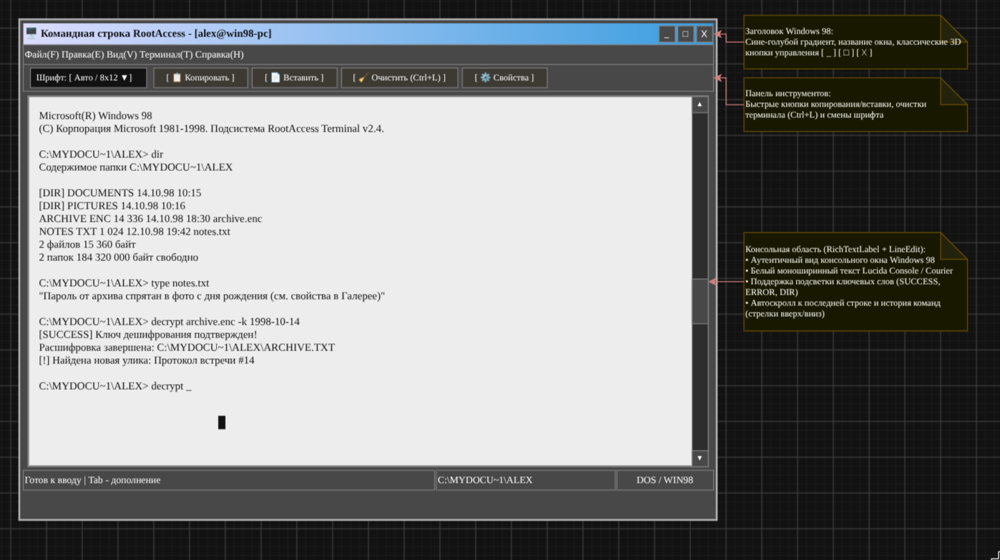
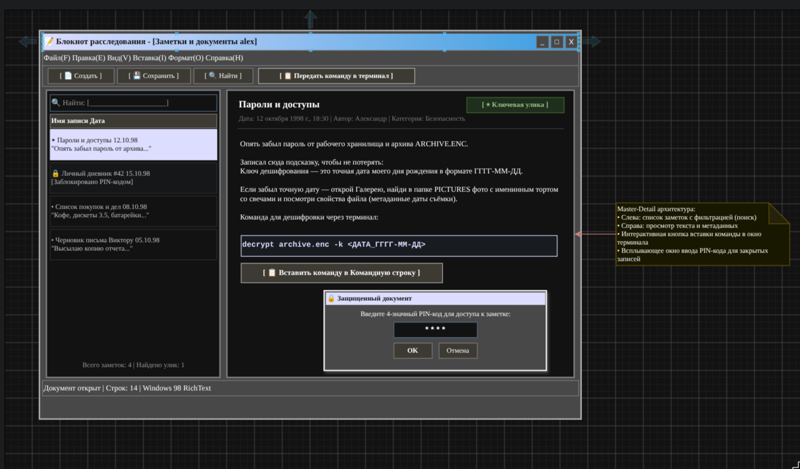
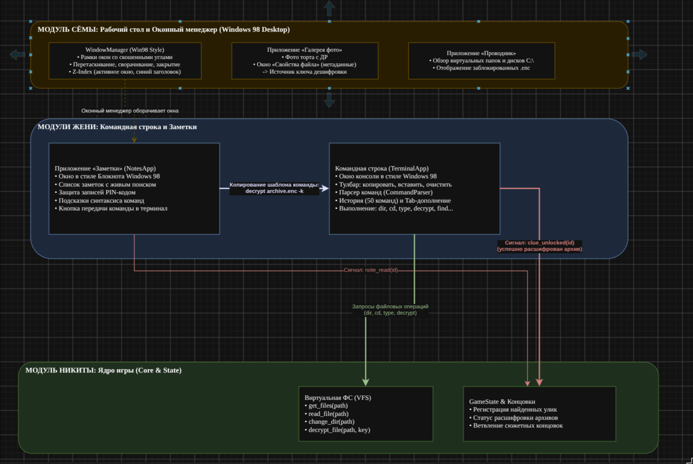

# Спецификация требований к ПО (SRS) — Root Access
## Проект: Детективный симулятор ноутбука серийного маньяка

**Проект:** root access — симулятор ноутбука серийного маньяка / детектив-триллер  
**Версия документа:** 0.1  
**Дата:** 12.11.2026  
**Статус:** черновик для согласования UI/UX и контентных требований  
**Движок:** Godot 4.x  
**Название игровой ОС:** FARA OS (рабочее, может быть заменено)

---

## 1. Назначение документа

Документ описывает требования к интерфейсу игрового ноутбука: экрану входа, рабочему столу, панели задач, оконному менеджеру, проводнику, диалогу свойств файла, галерее и просмотрщику фотографий. Отдельно фиксируются требования к метаданным фотографий, потому что на них строится ключевая механика поиска паролей.

SRS не фиксирует финальный сюжет и имена персонажей. Примеры файлов, дат и имён в документе — заглушки для проверки механик.

Документ предназначен для:

- гейм-дизайнера — как основа для контента и пазлов;
- UI/UX-дизайнера — как каркас экранов и состояний;
- разработчика — как список функциональных требований и критериев приёмки;
- тестировщика — как чек-лист проверки.

---

## 2. Границы задачи

### 2.1. Входит в объём

- имитация загрузки/экрана блокировки;
- рабочий стол с иконками, обоями и контекстным меню;
- панель задач, меню «Пуск», системный трей, часы, уведомления;
- оконный менеджер: перемещение, фокус, сворачивание, разворачивание, закрытие;
- проводник: навигация, навигационная строка с хлебными крошками, режимы просмотра, сортировка, поиск, скрытые файлы, защищённые папки, корзина;
- диалог свойств файла/папки, включая вкладку с метаданными изображения;
- галерея фотографий с альбомами и сеткой миниатюр;
- просмотрщик фото с зумом, навигацией и панелью сведений;
- простой просмотрщик текстовых заметок без редактирования;
- модальные окна пароля, ошибок и подтверждений;
- интеграционные точки с терминалом и системой сохранения прогресса;
- состояния загрузки, пустые состояния, ошибки и ограничения;
- базовые требования доступности, адаптивности и производительности.

### 2.2. Не входит в объём

- полноценные приложения почты, мессенджера, браузера и текстового редактора;
- настоящая файловая система, доступ к диску игрока или к сети;
- реальное шифрование и криптография;
- многопользовательский режим и синхронизация;
- мобильная версия и управление тачем;
- финальный сценарий, диалоги и все игровые концовки.

---

## 3. Принципы интерфейса

1. **Диегетичность.** Игрок видит интерфейс ноутбука, а не игровое HUD. Подсказки живут внутри файлов, заметок и уведомлений.
2. **Правдоподобие.** ОС выглядит цельной и знакомой по паттернам десктопных систем, но имеет собственный визуальный язык и не копирует Windows/macOS/Linux.
3. **Честные пазлы.** Каждый пароль выводится из информации, которую можно найти в системе. Метаданные не должны быть единственной неоднозначной подсказкой.
4. **Нет тупиков.** Игрок не может безвозвратно удалить критическую улику или навсегда заблокировать себе доступ.
5. **Каждое действие даёт обратную связь.** Кнопка, иконка или пункт меню всегда реагируют: открывают окно, меняют состояние или показывают понятное сообщение.
6. **Никаких мёртвых элементов.** В интерфейсе нет кнопок, которые выглядят рабочими, но ничего не делают.
7. **Спокойное исследование.** Интерфейс не подгоняет игрока таймерами и не наказывает за эксперименты.
8. **Читаемость важнее атмосферы.** Текст улик и дат не должен страдать из-за декоративных эффектов, низкого контраста или мелкого кегля.

---

## 4. Платформа и базовые ограничения

| Параметр | Требование |
|---|---|
| Движок | Godot 4.x |
| Платформы | Desktop: Windows 10/11 — P0; macOS 12+ и Linux x86_64 — P1 |
| Ориентация | Горизонтальная, 16:9 |
| Референсный размер | 1600 × 900 логических пикселей |
| Минимальный размер окна | 1280 × 720 |
| Поддержка больших экранов | Масштабирование UI без потери читаемости |
| Управление | Мышь и клавиатура |
| Язык интерфейса | Русский |
| Формат даты в интерфейсе | ДД.ММ.ГГГГ, время — 24 часа |
| Часовой пояс | Внутриигровой, фиксируется сценарием; реальное время игрока не влияет на пазлы |
| Сеть | Имитация; реальные сетевые запросы для геймплея не используются |
| Файловая система | Виртуальная, хранится в данных игры |
| Сохранение | Автосохранение прогресса в `user://`, отдельно от настроек отображения |

**Техническое ограничение:** игра не должна получать доступ к реальным файлам пользователя, камере, микрофону, контактам или сети. Все пути, файлы и уведомления — вымышленные. Оконный интерфейс игры не является настоящим оконным менеджером ОС.

---

## 5. Термины

| Термин | Значение |
|---|---|
| Игровая ОС | Вымышленная оболочка ноутбука (FARA OS) |
| Рабочий стол | Основной экран после входа |
| Проводник | Приложение для просмотра виртуальных файлов и папок |
| Галерея | Приложение «Фотографии», показывает альбомы и миниатюры |
| Просмотрщик | Полноэкранный режим просмотра одной фотографии |
| Свойства | Диалог с общей информацией и метаданными файла |
| Критический файл | Объект, необходимый для прохождения или понимания сюжета |
| Защищённая папка | Папка, открываемая после ввода пароля |
| Скрытый элемент | Файл/папка, скрытые по умолчанию до включения режима показа |
| Улика | Контент, который игрок может использовать для выводов |

---

## 6. Карта экранов и пользовательский поток

```text
[Загрузка / экран блокировки]
              │
              ▼
       [Рабочий стол]
       ├── Проводник ──► Свойства файла
       │       │
       │       └── Защищённая папка ──► Ввод пароля ──► Содержимое
       │
       ├── Фотографии ──► Галерея ──► Просмотрщик ──► Свойства фото
       │                                      │
       │                                      └── Копирование даты
       │
       ├── Заметки (текстовые файлы)
       ├── Терминал ──► расшифровка/разблокировка ──► обновление Проводника
       └── Уведомления и системные диалоги
              │
              ▼
       Финальное решение игрока ──► одна из концовок
```

**Ключевой цикл игрока:** осмотреть рабочий стол → открыть заметку → найти зацепку → открыть фото в галерее → проверить свойства и дату съёмки → вывести пароль → открыть скрытое → сопоставить улики → принять финальное решение.

**Важное правило:** стартовый экран не должен требовать пароль, который спрятан внутри системы. Если ноутбук заблокирован при старте, пароль должен быть доступен извне (записка рядом, подсказка на экране) либо игра начинается с уже разблокированного сеанса.

---

## 7. Общие требования к взаимодействию

- Одинарный клик выделяет объект. Двойной клик открывает папку, изображение или текстовую заметку. Для остальных файлов двойной клик не запускает приложение: доступны только свойства.
- Все интерактивные элементы имеют состояния: обычное, наведение, нажатие, фокус, выбрано, недоступно.
- Контекстное меню вызывается правой кнопкой мыши и клавишей контекстного меню / Shift+F10.
- Модальные окна захватывают фокус, закрываются по Esc и не теряются при клике мимо.
- Все ошибки формулируются на русском, без технических стектрейсов и кодов, не относящихся к сюжету.
- Долгие операции (открытие папки, загрузка фото) показывают индикатор, если задержка превышает 200 мс.
- Критические файлы защищены от удаления и переименования; причина показывается в диалоге.
- Прогресс сохраняется после значимых действий: открытие защищённой папки, просмотр ключевого фото, расшифровка файла, финальный выбор.
- Все видимые элементы должны быть доступны с клавиатуры, даже если основной способ — мышь.

---

## 8. Оболочка ОС

### 8.1. Экран загрузки и блокировки

**Рекомендация для MVP:** игра начинается с уже разблокированного рабочего стола. Экран блокировки можно использовать как переход/флешбэк, но не как обязательную головоломку на входе.

| ID | Приоритет | Требование |
|---|---|---|
| OS-01 | P0 | Экран загрузки показывает логотип FARA OS и индикатор не дольше 2–3 секунд; предусмотрен пропуск по клику/клавише после завершения загрузки данных. |
| OS-02 | P1 | Экран блокировки показывает обои, аватар, имя пользователя, часы и поле пароля. |
| OS-03 | P1 | Поле пароля маскирует символы; кнопка «Показать» временно показывает введённое значение. |
| OS-04 | P1 | Enter отправляет форму; Tab переключает фокус; ошибка не стирает весь экран и не блокирует попытки. |
| OS-05 | P1 | При неверном пароле показывается сообщение «Неверный пароль. Проверьте раскладку и формат» и мягкая анимация без резкого звука. |
| OS-06 | P1 | После 5 неудачных попыток доступна подсказка, если она предусмотрена сценарием: «Подсказка: проверьте заметки о датах». Она не раскрывает пароль напрямую. |
| OS-07 | P0 | Если экран блокировки требует пароль, пароль и подсказка к нему должны быть доступны до входа. Запрещён замкнутый круг «пароль находится только внутри заблокированной системы». |
| OS-08 | P1 | Caps Lock отображается отдельным индикатором. |
| OS-09 | P0 | Вход в систему не должен зависеть от реального системного времени. |

**Микрокопия:**

- заголовок: «Вход в FARA OS»;
- ошибка: «Неверный пароль. Попробуйте ещё раз.»;
- подсказка: «Подсказка: проверьте заметки о датах.»

### 8.2. Рабочий стол

| ID | Приоритет | Требование |
|---|---|---|
| OS-10 | P0 | Обои занимают весь экран; визуальный стиль — вымышленная ОС, без логотипов реальных ОС. |
| OS-11 | P0 | Иконки располагаются сеткой слева; подпись — до двух строк, полное имя доступно в тултипе. |
| OS-12 | P0 | Иконки показывают тип объекта: папка, текстовый файл, изображение, защищённый объект, корзина. |
| OS-13 | P0 | Одинарный клик выделяет иконку; двойной открывает папку, приложение, изображение или заметку. Для неподдерживаемых файлов двойной клик не запускает приложение. |
| OS-14 | P0 | Клавиши со стрелками перемещают выделение по сетке; Enter открывает выбранный объект. |
| OS-15 | P0 | Контекстное меню иконки содержит только реально поддерживаемые действия: «Открыть» (для папок и поддерживаемых файлов) и «Свойства». |
| OS-16 | P1 | Иконки можно перетаскивать в пределах сетки; позиции сохраняются в рамках сессии. |
| OS-17 | P1 | Клик по пустому месту снимает выделение; контекстное меню рабочего стола содержит «Обновить» и «Параметры экрана» (второй пункт может быть информационным). |
| OS-18 | P0 | Обои и декоративные элементы не являются единственным носителем критической подсказки. |
| OS-19 | P1 | На рабочем столе могут быть виджеты (часы/заметка), но они не перекрывают окна и не мешают работе. |

**Сетка рабочего стола:**

- область иконок: отступ 24 px от краёв;
- ячейка: 88 × 96 px;
- иконка: 48 × 48 px;
- межъячеечный отступ: 16 px;
- подпись: 12–13 px, максимум 2 строки.

### 8.3. Панель задач и меню «Пуск»

| ID | Приоритет | Требование |
|---|---|---|
| OS-20 | P0 | Панель задач закреплена внизу, высота 48 px, не перекрывается окнами. |
| OS-21 | P0 | Слева — кнопка меню; в центре/слева — закреплённые и запущенные приложения; справа — системный трей и часы. |
| OS-22 | P0 | Клик по приложению открывает его, повторный клик сворачивает/восстанавливает окно. Активное приложение имеет индикатор. |
| OS-23 | P0 | Меню «Пуск» открывается кнопкой, закрывается по Esc и клику вне меню. |
| OS-24 | P0 | В меню есть поиск по названиям приложений, список закреплённых приложений и «Все приложения». Поиск не индексирует содержимое файлов. |
| OS-25 | P0 | Результаты поиска приложений открываются по Enter; пустой результат показывает «Ничего не найдено». |
| OS-26 | P0 | Системный трей содержит сеть, звук, батарею и часы; каждый элемент по клику показывает небольшое информационное меню или настройку. |
| OS-27 | P0 | Часы показывают внутриигровое время в формате ЧЧ:ММ и дату в тултипе. |
| OS-28 | P1 | Громкость регулируется ползунком; звук можно отключить. Настройка сохраняется. |
| OS-29 | P1 | Сеть показывает вымышленное состояние («Нет сети», «Подключено») без реального подключения. |
| OS-30 | P1 | Батарея показывает процент и состояние питания; значение задаётся сценарием. |
| OS-31 | P0 | Все элементы трея доступны с клавиатуры и не являются декоративными пустышками. |

**Состав меню «Пуск» для MVP:**

- строка поиска;
- «Проводник»;
- «Фотографии»;
- «Заметки»;
- «Терминал»;
- «Настройки»;
- раздел «Все приложения»;
- кнопка завершения сеанса/выхода в меню игры (если предусмотрена).

**Запрещено:** показывать в меню приложения, которые не реализованы и не имеют внятного экрана-заглушки.

**Ограничение MVP:** «Заметки» — простой просмотрщик текстовых файлов. Создание, редактирование и форматирование заметок не входят в объём.

### 8.4. Оконный менеджер

| ID | Приоритет | Требование |
|---|---|---|
| OS-32 | P0 | Окно имеет заголовок, кнопки «Свернуть», «Развернуть/Восстановить», «Закрыть». |
| OS-33 | P0 | Окно перетаскивается за заголовок; порядок отрисовки окон пересчитывается корректно, активное окно выходит на передний план. |
| OS-34 | P0 | Клик по окну делает его активным; активное окно визуально отличается. |
| OS-35 | P0 | Окно нельзя утащить полностью за пределы экрана: минимум 48 px заголовка остаются видимыми. |
| OS-36 | P0 | Свернуть окно можно в панель задач; повторный клик восстанавливает его в прежнем размере и позиции. |
| OS-37 | P0 | Развернуть окно — на всю рабочую область над панелью задач; повторное нажатие возвращает исходный размер. |
| OS-38 | P0 | Закрытие окна не теряет прогресс; при наличии несохранённых изменений (если появятся) показывается подтверждение. |
| OS-39 | P0 | Диалоги свойств, пароля и подтверждений — модальные, блокируют взаимодействие с родительским окном. |
| OS-40 | P1 | Позиции и размеры окон сохраняются в рамках сессии; после перезапуска допустимо открывать приложения в размерах по умолчанию. |
| OS-41 | P1 | Двойной клик по заголовку разворачивает/восстанавливает окно. |
| OS-42 | P0 | Окна не должны перекрывать панель задач. |

**Размеры по умолчанию:**

| Приложение | Ширина × высота | Минимум |
|---|---|---|
| Проводник | 1040 × 640 | 880 × 520 |
| Фотографии | 1200 × 700 | 960 × 560 |
| Просмотрщик | 92% рабочей области | 960 × 560 |
| Свойства | 620 × 560 (по контенту) | 520 × 420 |
| Пароль | 420 × 280 | — |
| Заметки | 900 × 620 | 640 × 420 |

### 8.5. Уведомления

| ID | Приоритет | Требование |
|---|---|---|
| OS-43 | P0 | Уведомление появляется в правом верхнем углу поверх окон, но ниже модальных диалогов. |
| OS-44 | P0 | Уведомление содержит иконку, заголовок, текст и кнопку закрытия; интерактивные уведомления не исчезают слишком быстро. |
| OS-45 | P1 | Одновременно показывается не более трёх уведомлений; остальные встают в очередь. |
| OS-46 | P1 | История уведомлений доступна из трея; непрочитанные отмечены точкой. |
| OS-47 | P0 | Уведомления не содержат реальных внешних ссылок и не запускают внешние приложения. |

### 8.6. Диалог ввода пароля

| ID | Приоритет | Требование |
|---|---|---|
| OS-48 | P0 | Диалог пароля вызывается из защищённой папки, архива или соответствующего системного действия. |
| OS-49 | P0 | В диалоге видны название защищённого объекта, поле пароля, кнопки «Открыть» и «Отмена». |
| OS-50 | P0 | Пароль маскируется; есть кнопка временного показа. |
| OS-51 | P0 | Enter подтверждает, Esc отменяет, фокус сразу устанавливается в поле. |
| OS-52 | P0 | Неверный пароль показывает ошибку внутри диалога, не закрывая его. Поле очищается, фокус остаётся в поле. |
| OS-53 | P0 | Нет постоянной блокировки после нескольких попыток. Допустима только мягкая задержка или подсказка. |
| OS-54 | P0 | Для паролей-дат ввод нормализуется: принимаются `14061991`, `14.06.1991`, `14-06-1991`, `14 06 1991`. Пробелы и разделители игнорируются. |
| OS-55 | P0 | После успешной разблокировки диалог закрывается, а объект меняет состояние без перезапуска приложения. |
| OS-56 | P1 | После 5 неудачных попыток показывается ненавязчивая подсказка, заранее предусмотренная сценарием. |
| OS-57 | P0 | Диалог не раскрывает правильный формат, если это ломает загадку; формат должен быть указан в найденной записке или подсказке. |

---

## 9. Проводник

### 9.1. Назначение и общая структура

Проводник — основное приложение для исследования файлов. Он должен ощущаться как обычный файловый менеджер, а не как игровое меню улик.

**Структура окна:**

1. Заголовок окна с названием текущей папки и системными кнопками.
2. Панель навигации: «Назад», «Вперёд», «Вверх», хлебные крошки, поиск.
3. Левая боковая панель с быстрыми переходами.
4. Панель инструментов: режим просмотра, сортировка, обновление.
5. Контентная область: сетка значков или таблица.
6. Строка состояния: количество объектов, выделение, суммарный размер.

| ID | Приоритет | Требование |
|---|---|---|
| EX-01 | P0 | Проводник открывается с рабочего стола, из меню «Пуск» и по клику на папку. |
| EX-02 | P0 | Навигация «Назад/Вперёд» хранит историю переходов в рамках сессии. |
| EX-03 | P0 | Хлебные крошки кликабельны; текущая папка выделена, полный путь доступен в тултипе. Ручной ввод пути в MVP не требуется. |
| EX-04 | P0 | Кнопка «Вверх» переходит в родительскую папку; в корне она неактивна. |
| EX-05 | P0 | Слева отображаются «Рабочий стол», «Документы», «Изображения», «Загрузки», «Корзина» и сюжетные папки, если они доступны. |
| EX-06 | P1 | Текущий пункт боковой панели подсвечен. |
| EX-07 | P0 | Поиск ищет по именам файлов и папок в текущей папке и вложенных папках. Поиск по содержимому не входит в MVP. |
| EX-08 | P0 | Поиск показывает количество результатов и путь каждого объекта; скрытые элементы не попадают в выдачу, пока не включён их показ. |
| EX-09 | P0 | Пустой результат поиска: «Ничего не найдено. Попробуйте изменить запрос». |
| EX-10 | P0 | Поиск сбрасывается кнопкой очистки или при переходе в другую папку. |

### 9.2. Навигация и боковая панель

- Боковая панель — плоский список, без сложного дерева. Глубина вложенности показывается хлебными крошками.
- Нажатие на пункт открывает папку в текущем окне, история переходов сохраняется.
- Сюжетные папки могут появляться в боковой панели после разблокировки. Это допустимый способ feedback, но не единственный.
- «Корзина» всегда доступна; количество объектов в ней может отображаться бейджем.
- Если папка защищена, при переходе показывается диалог пароля; отмена возвращает в предыдущую папку.

### 9.3. Открытие файлов

Чтобы не реализовывать полноценные файловые ассоциации ОС, в MVP используется фиксированный набор поддерживаемых типов. Проводник не запускает внешние приложения и не открывает реальные файлы.

| Тип объекта | Действие по двойному клику / Enter |
|---|---|
| Папка | Открывается в проводнике |
| Изображение JPEG/PNG/WebP | Открывается во встроенном просмотрщике |
| Текстовая заметка TXT/MD | Открывается во встроенном просмотрщике заметок |
| Защищённая папка или архив | Открывается диалог пароля; после успеха — содержимое |
| Прочие файлы | Приложение не запускается; доступны только свойства |
| Повреждённый файл | Показывается диалог ошибки, приложение не запускается |

| ID | Приоритет | Требование |
|---|---|---|
| EX-OPEN-01 | P0 | В игре нет универсального «Открыть с помощью», выбора приложений и файловых ассоциаций ОС. |
| EX-OPEN-02 | P0 | Двойной клик и Enter выполняют только действия из таблицы выше; для прочих файлов открытие не предусмотрено. |
| EX-OPEN-03 | P0 | Для неподдерживаемого файла двойной клик показывает в строке состояния «Просмотр этого типа файлов недоступен» и не открывает окно. |
| EX-OPEN-04 | P0 | Изображения и заметки открываются только во встроенных приложениях игры; внешние программы не вызываются. |
| EX-OPEN-05 | P0 | Заметки открываются в режиме чтения; редактирование и сохранение изменений не входят в MVP. |
| EX-OPEN-06 | P0 | Файлы, похожие на исполняемые или скрипты, не запускаются ни при каких условиях. |
| EX-OPEN-07 | P1 | В контекстном меню неподдерживаемого файла пункт «Открыть» скрыт; остаются «Свойства» и разрешённые сервисные действия. |

### 9.4. Режимы просмотра

| ID | Приоритет | Требование |
|---|---|---|
| EX-11 | P0 | Режим «Значки»: сетка карточек, иконка, имя, для фото — миниатюра. |
| EX-12 | P0 | Режим «Таблица»: колонки «Имя», «Дата изменения», «Тип», «Размер»; в папке «Изображения» добавляется колонка «Дата съёмки». |
| EX-13 | P1 | Режим «Список» (компактные строки) может быть добавлен, но не обязателен для MVP. |
| EX-14 | P0 | Переключение режима не сбрасывает выделение и текущую папку. |
| EX-15 | P0 | Сортировка доступна по имени, дате изменения, типу, размеру; направление переключается. |
| EX-16 | P0 | Папки всегда идут перед файлами. |
| EX-17 | P0 | Длинные имена обрезаются многоточием; полное имя — в тултипе. |
| EX-18 | P0 | Миниатюры фотографий ленивые; при отсутствии миниатюры показывается нейтральная заглушка. |

**Значения по умолчанию:**

- режим — «Значки»;
- сортировка — по имени, папки сверху;
- размер карточки в сетке — 132 × 120 px;
- таблица — высота строки 34 px, заголовок 36 px.

### 9.5. Объекты и их состояния

| Состояние | Внешний вид | Поведение |
|---|---|---|
| Поддерживаемый файл | Стандартная иконка типа | Открывается встроенным просмотрщиком |
| Прочий файл | Иконка без действия открытия | Двойной клик не запускает приложение; доступны свойства |
| Папка | Иконка папки | Открывается, содержимое обновляется |
| Скрытый элемент | Полупрозрачная иконка, метка «Скрытый» в таблице | Виден только при включённом показе скрытых |
| Защищённый объект | Замок/щит на иконке | Открывает диалог пароля |
| Зашифрованный файл | Замок и тип «Зашифрованный архив» | Открывает пароль или инструкцию терминала |
| Повреждённый файл | Предупреждающий значок | Открывает диалог ошибки |
| Критический файл | Обычный вид + атрибут «Только чтение» в свойствах | Удаление и переименование недоступны |
| Удалённый файл | Находится в корзине | Можно восстановить |
| Выбранный объект | Заливка акцентом 15–20%, рамка | Действует на панель инструментов/контекстное меню |

| ID | Приоритет | Требование |
|---|---|---|
| EX-19 | P0 | Скрытые элементы включаются через меню «Вид» → «Показывать скрытые элементы». Пункт меню видимый, не спрятан только за горячей клавишей. |
| EX-20 | P0 | Состояние показа скрытых элементов сохраняется на время сессии. |
| EX-21 | P0 | При включении показывается системное сообщение «Скрытые элементы отображаются». |
| EX-22 | P0 | Защищённая папка при двойном клике вызывает диалог пароля; после успеха замок снимается, содержимое открывается. |
| EX-23 | P0 | Если объект повреждён, показывается сообщение с понятным объяснением и возможностью закрыть диалог. Технические подробности могут быть частью сюжета, но не должны быть единственным выходом. |
| EX-24 | P0 | Критические файлы нельзя удалить и переименовать. При попытке — сообщение «Этот файл защищён от изменений». |
| EX-25 | P1 | Некритические файлы можно удалить в корзину; удаление требует подтверждения. |
| EX-26 | P1 | В корзине доступны «Восстановить» и «Очистить корзину». Очистка необратима и требует явного подтверждения. |
| EX-27 | P0 | В MVP не требуется копирование/перемещение файлов drag-and-drop между папками. |

### 9.6. Контекстное меню

Для поддерживаемого файла:

- «Открыть»;
- «Свойства»;
- «Удалить» (только для некритических, P1).

Для неподдерживаемого файла:

- «Свойства»;
- «Удалить» (только для некритических, P1).

Для папки:

- «Открыть»;
- «Свойства».

Для пустого места:

- «Обновить»;
- «Параметры вида» (переключатель скрытых элементов, режим отображения).

**Правило:** не показывать пункты, которые не реализованы. Если действие недоступно для конкретного объекта, его можно показать неактивным с пояснением в строке состояния.

### 9.7. Свойства файла и папки

Диалог свойств — ключевой элемент пазла. Он должен быть доступен из проводника, галереи и просмотрщика.

| ID | Приоритет | Требование |
|---|---|---|
| PR-01 | P0 | Диалог открывается по правой кнопке → «Свойства», по Alt+Enter и из панели сведений фото. |
| PR-02 | P0 | Вкладка «Общие» показывает имя, тип, расположение, размер, даты создания/изменения и атрибуты. |
| PR-03 | P0 | Для изображения доступна вкладка «Подробно» с метаданными. |
| PR-04 | P0 | Дата съёмки отображается заметно и полностью: `14.06.2023, 18:42`. Не допускается обрезка или скрытие даты в тултипе. |
| PR-05 | P0 | Рядом с датой есть кнопка «Копировать дату»; копируется `14.06.2023` без времени. |
| PR-06 | P1 | У каждого значения есть действие «Копировать» или возможность выделить текст. |
| PR-07 | P0 | Если метаданных нет, показывается «Нет данных», а не подставляется дата изменения файла. |
| PR-08 | P1 | Для папки показываются количество объектов и суммарный размер. |
| PR-09 | P0 | Диалог закрывается по Esc, «Отмена» и «OK»; «OK» не вносит изменений, если редактирование не предусмотрено. |
| PR-10 | P0 | Диалог не должен вмещать контент, который нельзя прочитать при 1280 × 720; длинные значения переносятся или получают прокрутку. |

**Поля вкладки «Подробно» для изображения:**

| Поле | Обязательность | Примечание |
|---|---|---|
| Описание | P1 | Может содержать сюжетную подсказку |
| Автор | P1 | Может быть пустым |
| Дата съёмки | P0 | Основное поле пазла; формат ДД.ММ.ГГГГ, время отдельно |
| Камера / модель | P0 | Вымышленный бренд, без реальных логотипов |
| Разрешение | P0 | Например, `6000 × 4000` |
| Размер файла | P0 | В читаемом формате |
| Диафрагма | P1 | Может отсутствовать |
| Выдержка | P1 | Может отсутствовать |
| ISO | P1 | Может отсутствовать |
| Фокусное расстояние | P1 | Может отсутствовать |
| Программное обеспечение | P1 | Может указывать на редактирование |
| Комментарий | P1 | Может содержать текст с торта/записки |
| GPS | P1 | Только если нужно сюжету; без интерактивной карты |

**Правило для метаданных:** дата съёмки не должна зависеть от часового пояса машины игрока. В данных хранится «наивная» дата, которая отображается как есть.

---

## 10. Галерея и просмотрщик фотографий

### 10.1. Галерея: общая структура

Галерея — отдельное приложение «Фотографии». Она показывает альбомы и фотографии, но не дублирует файловый менеджер один в один.

**Структура:**

1. Заголовок окна.
2. Левая панель: «Все фото», «Недавние», список альбомов.
3. Шапка контента: название альбома, количество фото, сортировка, переключатель размера сетки.
4. Сетка миниатюр с группировкой по датам.
5. Строка состояния: количество, выделение, дата съёмки выбранного фото.

| ID | Приоритет | Требование |
|---|---|---|
| GA-01 | P0 | «Все фото» агрегирует все доступные изображения из папки «Изображения» и её подпапок. |
| GA-02 | P0 | Альбомы соответствуют папкам с фотографиями; пустые альбомы показываются с пустым состоянием. |
| GA-03 | P0 | «Недавние» показывает недавно добавленные/изменённые фотографии; логика явно подписана, чтобы не путать с датой съёмки. |
| GA-04 | P0 | Сетка миниатюр адаптивная: от 4 колонок на 1280 px до 6 на 1600 px; минимальная ширина карточки — 168 px. |
| GA-05 | P0 | Миниатюры не обрезают важные детали без возможности открыть фото; карточка использует изображение целиком с полями (contain) или безопасный кроп с явным открытием полного кадра. |
| GA-06 | P0 | Под миниатюрой — имя файла; дата не дублируется на каждой карточке, но доступна в тултипе и строке состояния. |
| GA-07 | P0 | Сортировка: по дате съёмки (по умолчанию, новые сверху), по имени, по дате изменения. |
| GA-08 | P0 | Группировка по дате съёмки: заголовок вида «14 июня 2023 · 12 фото». |
| GA-09 | P0 | Двойной клик или Enter открывает просмотрщик; выделение сохраняется. |
| GA-10 | P0 | Стрелки перемещают выделение по сетке, Enter открывает выбранное фото. |
| GA-11 | P0 | Пустой альбом: «В этом альбоме пока нет фотографий». |
| GA-12 | P0 | Ошибка загрузки миниатюры — нейтральная заглушка с именем файла и возможностью открыть свойства. |
| GA-13 | P1 | Поиск по имени файла внутри галереи. |
| GA-14 | P1 | Переключатель размера миниатюр (S/M/L) с сохранением в сессии. |
| GA-15 | P0 | Галерея корректно отображает скрытые/защищённые альбомы согласно состоянию файловой системы. |

### 10.2. Просмотрщик фотографий

| ID | Приоритет | Требование |
|---|---|---|
| PV-01 | P0 | Просмотрщик открывается поверх галереи/проводника в отдельном окне или полноэкранном слое. |
| PV-02 | P0 | Верхняя панель: имя файла, счётчик «3 из 12», кнопка сведений, зум, закрытие. |
| PV-03 | P0 | По умолчанию фото вписано в область просмотра целиком (fit), без обрезки и искажения пропорций. |
| PV-04 | P0 | Зум: кнопки «−», «+», «100%», «Вписать»; Ctrl+колесо мыши; двойной клик переключает между fit и 100%. |
| PV-05 | P0 | При зуме больше области доступно панорамирование перетаскиванием. |
| PV-06 | P0 | Навигация «предыдущее/следующее» стрелками и экранными кнопками; переход циклический в пределах текущего альбома. |
| PV-07 | P0 | Esc закрывает просмотрщик и возвращает в исходный контекст с сохранённой позицией скролла и выделением. |
| PV-08 | P0 | Клавиша `I` включает/выключает панель сведений. |
| PV-09 | P0 | Панель сведений показывает имя файла, дату съёмки, разрешение, размер, камеру и кнопку «Все свойства». |
| PV-10 | P0 | Дата съёмки в панели сведений видна сразу, без наведения и без открытия свойств. |
| PV-11 | P0 | При открытии из проводника кнопка «Назад» возвращает в проводник, из галереи — в галерею. |
| PV-12 | P1 | Следующее/предыдущее фото предзагружается для быстрого переключения. |
| PV-13 | P0 | Ошибка загрузки: «Не удалось открыть изображение» + «Повторить»; файл не заменяется заглушкой без пояснения. |
| PV-14 | P0 | Просмотрщик не показывает системный курсор в виде крестика; используется обычный указатель, при перетаскивании — «рука». |
| PV-15 | P1 | Слайд-шоу не входит в MVP. |

### 10.3. Панель сведений и свойства фото

- Панель сведений — правый блок шириной 320 px, может сворачиваться.
- На узких окнах (меньше 1100 px) панель открывается поверх изображения с возможностью закрыть.
- Заголовок панели — «Сведения».
- Ключевые поля: «Дата съёмки», «Разрешение», «Камера», «Размер».
- Кнопка «Все свойства» открывает тот же диалог, что и в проводнике.
- Дата должна быть доступна для копирования отдельной кнопкой.
- Если фото не имеет EXIF, панель честно показывает «Нет данных», а не дату изменения файла.

### 10.4. Сценарий пазла с датой рождения

Пример цепочки, который должен поддерживаться интерфейсом:

1. В заметках игрок находит запись: «Архив с личным — пароль: моя дата рождения, формат ДДММГГГГ, без точек».
2. В галерее открывает альбом «День рождения».
3. На фото видит торт со свечами «32» и людей.
4. Открывает «Свойства» → «Подробно» и видит дату съёмки `14.06.2023, 18:42`.
5. Понимает, что photographed birthday — 14 июня 2023 года, а возраст — 32 года.
6. Вычисляет дату рождения: 14.06.1991.
7. Вводит `14061991` (или `14.06.1991` — нормализация допускается).
8. Защищённая папка открывается.

**Важно:** дата съёмки фото с праздником не равна дате рождения напрямую. Интерфейс должен поддерживать связку «дата события + возраст/год» и не создавать логическую дыру, где игрок не может вывести год. Для каждого пароля нужна минимум одна дополнительная зацепка (возраст, запись, подпись на торте), чтобы пазл был честным.

---


## 11. Подсистема «Терминал» (консоль команд)
*(Разработчик модуля: Евгений, ветка docs/srs)*

### 2.1. Общие требования к окну и поведению
1. **Оконный режим:** Терминал запускается в виде отдельного окна виртуальной ОС (интеграция с оконной системой Сёмы: сворачивание, закрытие, перемещение).
2. **Экран вывода (Output):**
   - Текстовая область с поддержкой цветного текста (BBCode) для подсветки ошибок, директорий, зашифрованных файлов и подсказок.
   - Автоматическая прокрутка к последней выведенной строке при появлении нового текста.
3. **Строка ввода (Command Input):**
   - Однострочное поле с префиксом приглашения (prompt): `user@laptop:path$ `.
   - Автоматический фокус на поле ввода при клике в любое место окна терминала.
4. **История команд (History):**
   - Навигация по ранее введенным командам с помощью клавиш `Стрелка вверх` (предыдущая) и `Стрелка вниз` (следующая).
   - Хранение последних 50 введенных команд в рамках текущей игровой сессии.
5. **Автодополнение (Tab Completion):**
   - Нажатие `Tab` дополняет имя команды или название файла/папки в текущей директории.
6. **Горячие клавиши:**
   - `Ctrl + L` — быстрая очистка экрана (аналог команды `clear`).
   - `Ctrl + C` — отмена ввода текущей команды и перенос строки.
7. **Безопасность (Игровая песочница):**
   - Терминал работает строго внутри виртуальной файловой системы игры (VFS Никиты). Никакие реальные системные команды компьютера игрока не выполняются.

### 2.2. Схема интерфейса «Терминал» (Windows 98)


---

### 11.3. Спецификация команд терминала

Команды делятся на **системно-навигационные** (базовые) и **сюжетно-игровые** (для расследования).

| Команда | Синтаксис | Назначение | Поведение и результат |
| :--- | :--- | :--- | :--- |
| **help** | `help [команда]` | Справка | Выводит список доступных команд. Если указан аргумент (например, `help decrypt`), выводит правила использования этой команды. |
| **clear** (алиас: `cls`) | `clear` | Очистка | Полностью очищает поле вывода терминала. |
| **pwd** | `pwd` | Текущий путь | Выводит полный путь к текущей виртуальной директории (например: `/home/user/documents`). |
| **ls** (алиас: `dir`) | `ls [-a] [папка]` | Список файлов | Выводит файлы и подпапки. Флаг `-a` открывает скрытые файлы (начинающиеся с точки). Папки, файлы и зашифрованные данные визуально выделяются разными цветами. |
| **cd** | `cd [путь]` | Смена папки | Переход по виртуальным директориям (`cd ..` — назад, `cd /` — корень, `cd ~` — домашняя папка, `cd docs` — вход в папку). При ошибке: `Папка не найдена`. |
| **cat** (алиас: `read`) | `cat <файл>` | Чтение файла | Выводит содержимое текстового файла. Если файл зашифрован (`.enc`), выводит сообщение: *«Файл зашифрован. Требуется утилита decrypt»*. |
| **decrypt** (алиас: `decode`) | `decrypt <файл> -k <ключ>` | Расшифровка | **Сюжетная механика:** расшифровывает защищенный файл с помощью ключа/пароля, найденного игроком. При успехе создает расшифрованный файл и регистрирует улику. При ошибке: *«Неверный ключ»*. |
| **find** (алиас: `search`) | `find <запрос>` | Поиск | Ищет файлы по названию или маске в текущей директории и подпапках. |
| **whoami** | `whoami` | Текущий юзер | Выводит имя текущей учетной записи (например, `alex` или `guest`). |
| **history** | `history` | История | Выводит нумерованный список введенных ранее команд (включая предустановленные "старые" команды владельца для сюжетных зацепок). |
| **sudo** / **su** | `sudo <команда>` | Root-доступ | Игровая ловушка/пасхалка. Запрашивает пароль root. При неверном вводе выводит предупреждение о нарушении прав доступа. |
| **exit** | `exit` | Выход | Закрывает окно терминала. |

---

---

## 12. Подсистема «Заметки»
*(Разработчик модуля: Евгений, ветка docs/srs)*

### 4.1. Общие требования к интерфейсу
1. **Двухпанельный макет (Master-Detail):**
   - **Левая панель:** вертикальный список всех заметок с кратким превью и датой.
   - **Правая панель:** область чтения выбранной заметки (заголовок, дата создания/изменения, основной текст).
2. **Поиск и фильтрация:**
   - Поле ввода над списком заметок для живого поиска по заголовкам и содержимому.
3. **Форматирование текста:**
   - Поддержка богатого текста (BBCode):
     - Жирный и курсивный шрифт для акцентов в тексте;
     - Моноширинный блок кода для консольных команд (чтобы игрок сразу видел синтаксис команды);
     - Зачеркнутый текст для списков задач / покупок.
4. **Защищенные заметки (Механика блокировки):**
   - Возможность пометки заметки как закрытой (иконка замка).
   - При клике на такую заметку появляется окно ввода PIN-кода (или пароля). Контент скрыт до верного ввода.
5. **Взаимодействие с терминалом:**
   - Кнопка «Скопировать команду» или интерактивная ссылка в тексте заметки, которая копирует синтаксис консольной команды в буфер обмена или сразу передает её в окно терминала.
6. **Маркировка улик:**
   - Визуальный индикатор (звездочка / бейдж «Улика») для сюжетно важных заметок после их прочтения.

### 4.2. Схема интерфейса «Заметки» (Windows 98)


---

---


## 13. Ядро игры, виртуальная файловая система (VFS) и концовки
*(Разработчик модуля: Никита, Team Lead)*

### 13.1. Сюжетный цикл и расследование
1. Игрок получает доступ к ноутбуку серийного маньяка (интерфейс в ретро-стиле конца 90-х).
2. Исследует открытые каталоги Проводника, фотографии в Галерее и Заметки в поисках улик, дат и консольных команд.
3. Находит скрытые пароли через метаданные (например, дата на фото торта в свойствах файла дает пароль от зашифрованной папки маньяка).
4. Запускает Терминал и использует команды (`decrypt`, `find`, `cat`, `ls -a`) для поиска скрытых логов и расшифровки файлов формата `.enc`.
5. На основе собранных улик и принятых решений выходит на одну из 3+ сюжетных концовок:
   - **Концовка 1 (Успех):** маньяк вычислен, доказательства расшифрованы, жертва спасена.
   - **Концовка 2 (Провал/Ловушка):** игрок ошибся, маньяк понял, что в его компьютере копаются, и выследил игрока.
   - **Концовка 3 (Упущенное время):** найдены не все улики, маньяк скрылся.

### 13.2. Функциональные требования к ядру
- **FR-CORE-1 (Загрузка VFS):** Ядро игры должно парсить и инициализировать дерево виртуальных файлов и папок из файлов конфигурации JSON (`res://data/files.json`).
- **FR-CORE-2 (Единый API VFS):** Ядро предоставляет единые методы работы с файлами для Проводника и Терминала (`list_dir`, `read_file`, `decrypt_file`, `get_metadata`).
- **FR-CORE-3 (Менеджер GameState):** Централизованное отслеживание прогресса: список разблокированных файлов, открытых заметок, найденных улик и сюжетных триггеров.
- **FR-CORE-4 (Система концовок):** Определение финального экрана игры на основе набора флагов в `GameState`.
- **FR-CORE-5 (Изолированные сохранения):** Сохранение состояния в `user://save.json` с возможностью сброса для повторного прохождения.

### 13.3. Архитектура взаимодействия модулей


- **С Никитой (Ядро и VFS):**
  - Терминал не хранит файловое дерево сам, а запрашивает данные у VFS Никиты (`list_dir`, `read_file`, `decrypt_file`).
  - При успешном расшифровании или прочтении важной заметки отправляется сигнал в систему прогресса Никиты.
- **С Сёмой (Рабочий стол и Окна):**
  - Терминал и Заметки оформляются по единым правилам оконного интерфейса Сёмы (стандартные кнопки свернуть/закрыть, рамка, фокус окна).
- **С Мишей (Сюжет, Контент и Документация):**
  - Все тексты заметок, команды, пароли и описания выносятся в отдельный файл данных (например, `notes.json`), чтобы Миша мог наполнять сюжет без правок кода.

### 5.1. Блок-схема алгоритма парсера команд


### 5.2. Схема взаимодействия и архитектуры модулей


---

---

## 14. Вайрфреймы

Ниже — схематические вайрфреймы для ТЗ. Размеры и пропорции ориентировочные; финальная визуальная стилистика уточняется у арт-директора.

### 11.1. Экран блокировки (опционально)

```text
┌──────────────────────────────────────────────────────────────────────────────┐
│                                                                   12:47      │
│                                                                              │
│                              ┌──────────────┐                                │
│                              │    АВАТАР    │                                │
│                              │              │                                │
│                              └──────────────┘                                │
│                                  Алиса                                      │
│                                                                              │
│                    ┌────────────────────────────────────┐                    │
│                    │ Пароль                        [показать] │                │
│                    └────────────────────────────────────┘                    │
│                                                                              │
│                    [                 Войти                 ]                 │
│                                                                              │
│                    ⚠ Неверный пароль. Попробуйте ещё раз.                    │
│                                                                              │
│                    Подсказка: проверьте заметки о датах.                     │
└──────────────────────────────────────────────────────────────────────────────┘
```

### 11.2. Рабочий стол с открытым проводником

```text
┌──────────────────────────────────────────────────────────────────────────────┐
│                                                                              │
│   ┌──────────┐   ┌──────────┐                                                │
│   │  ПАПКА   │   │  ФАЙЛ    │              обои: приглушённый снимок        │
│   │ Проекты  │   │ Заметки  │                                                │
│   └──────────┘   └──────────┘                                                │
│                                                                              │
│       ┌─ Проводник — Изображения ────────────────────────────── [—][□][×]┐   │
│       │ ←  →  ↑   ⌂ / Изображения / День рождения              [Поиск...]│   │
│       │ ┌────────────┐ ┌───────────────────────────────────────────────┐ │   │
│       │ │ Быстрый    │ │ [Значки] [Таблица]             Сортировка ▾  │ │   │
│       │ │ доступ     │ │  ┌────────┐ ┌────────┐ ┌────────┐            │ │   │
│       │ │ Рабочий... │ │  │  ФОТО  │ │  ФОТО  │ │  ФОТО  │            │ │   │
│       │ │ Документы  │ │  │ IMG_01 │ │ IMG_02 │ │ IMG_03 │            │ │   │
│       │ │ Изображения│ │  └────────┘ └────────┘ └────────┘            │ │   │
│       │ │ Загрузки   │ │  ┌────────┐ ┌────────┐ ┌────────┐            │ │   │
│       │ │ Корзина    │ │  │  ФОТО  │ │  ФОТО  │ │  ФОТО  │            │ │   │
│       │ │            │ │  └────────┘ └────────┘ └────────┘            │ │   │
│       │ └────────────┘ │  12 объектов · 46,8 МБ                       │ │   │
│       │                └───────────────────────────────────────────────┘ │   │
│       └────────────────────────────────────────────────────────────────────┘   │
│                                                                              │
│  [МЕНЮ] [Проводник] [Фотографии] [Заметки] [Терминал]   Сеть  Звук  84%  12:47│
└──────────────────────────────────────────────────────────────────────────────┘
```

**Аннотации:**

1. Иконки рабочего стола — отдельный слой, не перекрываемый панелью задач.
2. Заголовок окна — drag-зона; кнопки справа.
3. Хлебные крошки — кликабельные; текущая папка не кликабельна.
4. Поиск — справа в панели навигации.
5. Боковая панель — фиксированная ширина 216 px.
6. Панель инструментов — режимы и сортировка.
7. Контент — сетка или таблица.
8. Строка состояния — количество, выделение, размер.
9. Панель задач — 48 px, поверх неё окна не заходят.

### 11.3. Меню «Пуск»

```text
┌──────────────────────────────────────────┐
│  🔍 Поиск приложений                     │
│                                          │
│  Закреплённые                            │
│  ┌────────┐ ┌────────┐ ┌────────┐        │
│  │Провод- │ │Фото-   │ │Заметки │        │
│  │ник     │ │графии  │ │        │        │
│  └────────┘ └────────┘ └────────┘        │
│  ┌────────┐ ┌────────┐                   │
│  │Терминал│ │Настрой-│                   │
│  │        │ │ки      │                   │
│  └────────┘ └────────┘                   │
│                                          │
│  Все приложения                      ›   │
│  ─────────────────────────────────────   │
│  Алиса                         [Выход]   │
└──────────────────────────────────────────┘
```

### 11.4. Проводник: режим «Таблица»

```text
┌─ Проводник — Изображения / День рождения ─────────────────── [—][□][×]┐
│ ←  →  ↑   ⌂ / Изображения / День рождения                [Поиск...]   │
│ ┌────────────┐ ┌─────────────────────────────────────────────────────┐ │
│ │ Быстрый    │ │ [Значки] [Таблица]                    Сортировка ▾ │ │
│ │ доступ     │ │ Имя            Дата съёмки   Тип      Размер       │ │
│ │ Рабочий... │ │ ─────────────────────────────────────────────────── │ │
│ │ Документы  │ │ IMG_2040.jpg   14.06.2023    JPEG     4,8 МБ       │ │
│ │ Изображения│ │ IMG_2041.jpg   14.06.2023    JPEG     5,1 МБ       │ │
│ │ Загрузки   │ │ IMG_2042.jpg   14.06.2023    JPEG     4,4 МБ       │ │
│ │ Корзина    │ │ IMG_2043.jpg   14.06.2023    JPEG     5,6 МБ       │ │
│ │            │ │ ...                                                │ │
│ │            │ │ 12 объектов · выбрано 1 · 46,8 МБ                  │ │
│ └────────────┘ └─────────────────────────────────────────────────────┘ │
└────────────────────────────────────────────────────────────────────────┘
```

### 11.5. Галерея

```text
┌─ Фотографии ───────────────────────────────────────────────────── [—][□][×]┐
│ ←  Все фото   Недавние                         [Сортировка: дата ▾] [i] │
│ ┌──────────────┐ ┌─────────────────────────────────────────────────────┐ │
│ │ Все фото  48 │ │ День рождения · 12 фото                             │ │
│ │ Недавние     │ │                                                     │ │
│ │ ─ Альбомы    │ │ 14 июня 2023 · 12 фото                              │ │
│ │ День рождения│ │ ┌────────┐ ┌────────┐ ┌────────┐ ┌────────┐        │ │
│ │ Поездка      │ │ │  ФОТО  │ │  ФОТО  │ │  ФОТО  │ │  ФОТО  │        │ │
│ │ Архив        │ │ │ IMG_20 │ │ IMG_20 │ │ IMG_20 │ │ IMG_20 │        │ │
│ │              │ │ └────────┘ └────────┘ └────────┘ └────────┘        │ │
│ │              │ │ ┌────────┐ ┌────────┐ ┌────────┐ ┌────────┐        │ │
│ │              │ │ │  ФОТО  │ │  ФОТО  │ │  ФОТО  │ │  ФОТО  │        │ │
│ │              │ │ └────────┘ └────────┘ └────────┘ └────────┘        │ │
│ │              │ │                                                     │ │
│ └──────────────┘ └─────────────────────────────────────────────────────┘ │
│ 12 фото · выбрано: 1 · дата съёмки: 14.06.2023                            │
└────────────────────────────────────────────────────────────────────────────┘
```

**Аннотации:**

1. Слева — агрегаты и альбомы.
2. Шапка — название альбома и сортировка.
3. Группировка по дате съёмки.
4. Карточка — изображение + имя файла.
5. Строка состояния показывает дату выбранного фото — это помогает пазлу без открытия свойств.
6. Кнопка `i` в MVP может открывать выделенное фото/сведения; если это неочевидно, заменить на «Сведения».

### 11.6. Просмотрщик с панелью сведений

```text
┌─ IMG_2043.jpg ─────────────────────────────────────── [i] [−] [100%] [+] [×]┐
│                                                                             │
│  ←        ┌───────────────────────────────────────────────┐          →    │
│           │                                               │               │
│           │              ФОТО: ТОРТ, СВЕЧИ «32»           │               │
│           │                                               │               │
│           │                                               │               │
│           └───────────────────────────────────────────────┘               │
│                                                                             │
│  ┌ Сведения ────────────────────────────┐                                   │
│  │ Файл          IMG_2043.jpg           │                                   │
│  │ Дата съёмки   14.06.2023, 18:42 [копировать]                             │
│  │ Разрешение    6000 × 4000            │                                   │
│  │ Камера        Orion X20              │                                   │
│  │ Размер        5,6 МБ                 │                                   │
│  │                                      │                                   │
│  │ [Все свойства]                       │                                   │
│  └──────────────────────────────────────┘                                   │
│                                                                             │
│                           ◀   4 из 12   ▶                                    │
└─────────────────────────────────────────────────────────────────────────────┘
```

### 11.7. Диалог свойств фото

```text
┌─ Свойства: IMG_2043.jpg ──────────────────────────────────────────── [×] ┐
│ [Общие] [Подробно]                                                        │
│                                                                           │
│ Свойство              Значение                                            │
│ ───────────────────────────────────────────────────────────────────────── │
│ Имя файла             IMG_2043.jpg                                        │
│ Тип                   Изображение JPEG                                    │
│ Расположение          Изображения \ День рождения                         │
│ Дата съёмки           14.06.2023, 18:42                    [Копировать]  │
│ Разрешение            6000 × 4000                                         │
│ Камера                Orion X20                                           │
│ Диафрагма             f/2.8                                               │
│ Выдержка              1/125                                                │
│ ISO                   400                                                  │
│ Комментарий           «32»                                                 │
│                                                                           │
│                                                    [OK] [Отмена]          │
└───────────────────────────────────────────────────────────────────────────┘
```

**Аннотации к свойствам:**

- «Дата съёмки» — самое заметное текстовое поле после имени.
- Кнопка «Копировать» копирует дату без времени.
- Вкладка «Общие» содержит системные даты и атрибуты, но не подменяет дату съёмки.
- Длинные значения переносятся, диалог прокручивается.

### 11.8. Диалог пароля для защищённой папки

```text
┌─ Защищённая папка ─────────────────────────────────────────────── [×] ┐
│                                                                       │
│  Папка «Архив» защищена паролем.                                      │
│                                                                       │
│  ┌───────────────────────────────────────────────────────────────┐    │
│  │ Пароль                                                  [показать] │ │
│  └───────────────────────────────────────────────────────────────┘    │
│                                                                       │
│  ⚠ Неверный пароль. Проверьте раскладку и формат.                     │
│                                                                       │
│                                             [Отмена] [Открыть]        │
└───────────────────────────────────────────────────────────────────────┘
```

### 11.9. Схема состояний ключевого пазла

```text
[Заметка с форматом пароля]
             │
             ▼
[Галерея: альбом «День рождения»]
             │
             ▼
[Просмотрщик: фото торта + свечи «32»]
             │
             ├──► [Свойства / Подробно: дата съёмки 14.06.2023]
             │
             ▼
[Вычисление: 2023 − 32 = 1991; дата 14.06.1991]
             │
             ▼
[Ввод 14061991] ──неверно──► [Ошибка, повтор без блокировки]
             │
           верно
             ▼
[Папка разблокирована] ──► [Новая улика / финальный выбор]
```

---

## 15. Сетка, размеры и слои

### 12.1. Базовые размеры

| Элемент | Значение |
|---|---|
| Референсный холст | 1600 × 900 |
| Минимальный холст | 1280 × 720 |
| Панель задач | 48 px |
| Кнопка меню | 40 × 40 px |
| Иконка приложения в панели задач | 28 × 28 px внутри кнопки 40 × 40 |
| Иконка рабочего стола | 48 × 48 px |
| Ячейка рабочего стола | 88 × 96 px, отступ 16 px |
| Заголовок окна | 40 px |
| Системная кнопка окна | 44 × 40 px |
| Боковая панель проводника | 216 px |
| Панель навигации проводника | 52 px |
| Строка таблицы | 34 px |
| Миниатюра в галерее | минимум 160 px по ширине, соотношение 1:1 |
| Панель сведений фото | 320 px |
| Диалог свойств | 620 px, максимум 80vh |
| Диалог пароля | 420 px |
| Радиус окна | 10 px |
| Радиус кнопок/полей | 6–8 px |

### 12.2. Адаптивность

- При ширине меньше 1440 px боковые панели не расширяются, контент получает прокрутку.
- При 1280 × 720 все ключевые действия должны быть доступны без горизонтального скролла страницы.
- Галерея использует адаптивную сетку с минимальной шириной карточки 160 px; количество колонок зависит от ширины окна.
- Диалог свойств прокручивается внутри, а не выходит за экран.
- При масштабе 125% интерфейс не должен обрезать дату и кнопки.
- Внутриигровая сцена масштабируется целиком; панель задач остаётся прижатой к низу.

### 12.3. Слои интерфейса

| Слой | Порядок отрисовки (снизу вверх) |
|---|---|
| Обои | 0 |
| Иконки рабочего стола | 10 |
| Окна приложений | 100+ |
| Панель задач | 900 |
| Меню «Пуск» | 910 |
| Уведомления | 950 |
| Модальные диалоги | 1000 |
| Системные подсказки/тултипы | 1100 |

---

## 16. Визуальный стиль

### 13.1. Характер

FARA OS — спокойная, немного «казённая» система с тёплым янтарным акцентом. Ощущение: ноутбук, которым пользовались несколько лет; аккуратный, но не стерильный интерфейс. Атмосферу создают обои, контент и звук, а не агрессивные эффекты.

### 13.2. Палитра

| Токен | Цвет | Использование |
|---|---|---|
| `bg-0` | `#0E1116` | Фон рабочего стола, просмотрщик |
| `bg-1` | `#151A21` | Фон окон |
| `bg-2` | `#1C232D` | Панели, заголовки |
| `surface` | `#222A35` | Карточки, поля |
| `surface-hover` | `#2B3542` | Hover |
| `border` | `#344050` | Границы, разделители |
| `text` | `#E9EEF5` | Основной текст |
| `text-muted` | `#A2AFBF` | Вторичный текст |
| `accent` | `#E6A23C` | Акцент, выделение, активные элементы |
| `accent-strong` | `#F0B95E` | Hover/фокус акцента |
| `info` | `#6EA8FE` | Информационные сообщения |
| `success` | `#58C39A` | Успешная разблокировка |
| `danger` | `#E06C75` | Ошибки, необратимые действия |

**Контраст:** основной текст — не ниже 4.5:1 к фону; вторичный — не ниже 4.5:1 для текста до 18 px; декоративные элементы — не ниже 3:1. Цвет не является единственным признаком состояния.

### 13.3. Типографика

- Основной шрифт: Golos Text, Inter или системный шрифт с полной поддержкой кириллицы.
- Заголовок окна: 14–16 px, medium/semibold.
- Заголовок экрана: 20–24 px, semibold.
- Основной текст: 14 px, line-height 1.45.
- Вторичный текст: 13 px.
- Минимум: 12 px; критическая дата не должна быть меньше 14 px.
- Для дат, счётчиков и размеров — табличные (моноширинные) цифры, если это поддерживает выбранный шрифт.
- Не использовать декоративный/рукописный шрифт для дат и системных сообщений.

### 13.4. Иконки и графика

- Собственный набор иконок, 24 px, штрих 2 px, скруглённые окончания.
- Не использовать иконки и логотипы Windows, macOS, Linux и реальных брендов.
- Типы файлов различаются формой и подписью, а не только цветом.
- Замок на защищённом объекте — отдельный оверлей, не заменяющий иконку типа.
- Обои — вымышленный снимок или абстракция; они не должны быть единственным носителем улики.

### 13.5. Движение и звук

- Анимации окон и меню: 120–180 мс, ease-out.
- Наведение и фокус: 80–120 мс.
- В настройках есть режим «Уменьшить анимации»; при его включении анимации отключаются или сокращаются.
- Звук интерфейса опционален, громкость регулируется, по умолчанию умеренная.
- Звук не является единственным сигналом успеха/ошибки.

### 13.6. Ограничения MVP

- Одна тёмная тема.
- Без кастомизации обоев игроком.
- Без виджетов, живых обоев и сложных эффектов размытия.
- Без анимации перелистывания страниц и 3D-эффектов.

---

## 17. Клавиатура и мышь

| Действие | Клавиши/мышь |
|---|---|
| Открыть папку/поддерживаемый файл | Двойной клик, Enter |
| Выделить | Один клик, стрелки |
| Контекстное меню | Правая кнопка, Shift+F10 |
| Свойства | Alt+Enter |
| Назад / вперёд в проводнике | Alt+← / Alt+→, кнопки |
| Вверх | Alt+↑, Backspace |
| Поиск в проводнике | Ctrl+F |
| Обновить вид | F5 |
| Выделить всё в проводнике | Ctrl+A |
| Закрыть меню/диалог | Esc |
| Переключение фокуса | Tab / Shift+Tab |
| Активировать кнопку | Enter / Space |
| Галерея: навигация | Стрелки, Home/End |
| Галерея: открыть фото | Enter |
| Просмотрщик: следующее/предыдущее | Стрелки |
| Просмотрщик: сведения | I |
| Просмотрщик: вписать | 0 |
| Просмотрщик: 100% | 1 |
| Просмотрщик: зум | + / −, Ctrl+колесо |
| Просмотрщик: закрыть | Esc |
| Пароль: подтвердить/отмена | Enter / Esc |
| Показать пароль | Кнопка «Показать», фокус Tab |

**Правила:**

- Не использовать одиночный клик для открытия (кроме кнопок и ссылок).
- Не делать hover единственным способом получить критическую информацию.
- Все горячие клавиши дублируются видимыми действиями.
- Двойной клик и Enter должны работать одинаково для поддерживаемых объектов; для остальных файлов оба действия не запускают приложение.
- При фокусе на карточке инструменты показывают подсказку, а не только меняют цвет.

---

## 18. Требования к контенту и честности пазлов

### 15.1. Правила пазлов

1. У каждого пароля есть минимум две зацепки в разных местах (например, дата события и возраст).
2. Формат пароля объясняется внутри игры, если он неочевиден.
3. Критическая информация доступна в текстовом виде, не только на изображении.
4. Метаданные не должны быть единственным источником истины, если их можно случайно изменить или не заметить.
5. Пароль нельзя «подобрать» перебором: интерфейс не показывает, какая часть верна, и не раскрывает длину.
6. Ошибка ввода не должна наказывать игрока таймером или блокировкой.
7. Скрытые папки должны обнаруживаться через понятную подсказку и видимый пункт меню, а не через случайный набор клавиш.
8. Файлы-обманки допустимы, но не должны быть единственным путём и не должны ломать логику.

### 15.2. Требования к фотографиям

- В ключевом альбоме 8–12 фотографий; ключевая фотография не должна быть единственной и очевидной по названию вроде `PASSWORD.jpg`.
- Фото должны выглядеть как личный архив: разные даты, ракурсы, качество, дубли.
- Для ключевого фото обязательны: дата съёмки, камера/модель, разрешение, размер, читаемый комментарий или визуальная деталь.
- Дата съёмки в свойствах и в панели сведений должна совпадать.
- Дата не должна «съезжать» из-за часового пояса.
- Миниатюра не должна скрывать ключевую деталь, если деталь нужна для пазла; при кропе обязательно открытие полного кадра.
- Не использовать реальные персональные данные, реальные номера, адреса и документы.
- Бренды камер/техники — вымышленные или обезличенные.
- Если контент содержит сцены насилия/тревожные изображения, перед показом предусмотреть предупреждение.

### 15.3. Пример карточки контента для пазла

| Параметр | Значение |
|---|---|
| Файл | `IMG_2043.jpg` |
| Альбом | «День рождения» |
| Визуал | Торт со свечами «32», гости, квартира |
| Дата съёмки | `14.06.2023, 18:42` |
| Комментарий | «32» |
| Дополнительная зацепка | Заметка: «родилась 14 июня» или подпись на торте |
| Вычисление | 2023 − 32 = 1991; месяц/день — 14.06 |
| Пароль | `14061991` |
| Допустимый ввод | `14061991`, `14.06.1991`, `14-06-1991` |
| Что открывается | Защищённая папка «Архив» |

### 15.4. Скрытые элементы

- Скрытая папка/файл имеет атрибут «скрытый» и не отображается по умолчанию.
- В меню «Вид» есть явный пункт «Показывать скрытые элементы» с горячей клавишей-дублёром.
- Подсказка о скрытых элементах должна быть в заметке, терминале или сюжетном сообщении.
- Скрытые элементы нельзя делать частью обязательного пути, если игрок не может найти сам переключатель; переключатель должен быть в стандартном меню.
- После включения скрытые файлы визуально отличаются, но остаются доступными.

---

## 19. Состояния и микрокопия

| Ситуация | Текст | Действие |
|---|---|---|
| Неверный пароль | «Неверный пароль. Проверьте раскладку и формат.» | Остаться в диалоге, очистить поле |
| Подсказка после попыток | «Подсказка: проверьте заметки о датах.» | Показать только если предусмотрено сценарием |
| Скрытые включены | «Скрытые элементы отображаются.» | Тост/строка состояния |
| Пустая папка | «В этой папке пока нет файлов.» | — |
| Пустая корзина | «Корзина пуста.» | — |
| Пустой поиск | «Ничего не найдено. Попробуйте изменить запрос.» | — |
| Нет метаданных | «Нет данных» | Не подставлять дату изменения |
| Повреждённый файл | «Не удалось открыть файл: данные повреждены.» | «Закрыть», при сюжете — подсказка |
| Изображение не загрузилось | «Не удалось открыть изображение.» | «Повторить» |
| Нет доступа | «Нет доступа к этому объекту.» | «Закрыть» |
| Защищённый файл | «Этот файл защищён от изменений.» | «Понятно» |
| Удаление | «Переместить в корзину?» | «Отмена», «Удалить» |
| Очистка корзины | «Очистить корзину? Восстановить файлы будет нельзя.» | «Отмена», «Очистить» |
| Нет сети | «Нет подключения к сети.» | Информационный статус |
| Приложение недоступно | «Приложение временно недоступно.» | Не показывать пустой экран |

**Правила микрокопии:**

- Короткие предложения, без канцелярита.
- Не раскрывать сюжет в системных сообщениях.
- Не использовать реальные технические коды ошибок; если код нужен как улика — он должен быть частью сценария.
- Одинаковые по смыслу ошибки формулируются одинаково.

---

## 20. Доступность

| ID | Приоритет | Требование |
|---|---|---|
| A11Y-01 | P0 | Все интерактивные элементы доступны с клавиатуры, порядок фокуса логичен. |
| A11Y-02 | P0 | Видимый фокус: рамка не менее 2 px, контраст к фону. |
| A11Y-03 | P0 | Контраст текста не ниже 4.5:1; крупного текста — не ниже 3:1. |
| A11Y-04 | P0 | Состояния не передаются только цветом: добавляются иконки, подписи или текст. |
| A11Y-05 | P0 | У изображений в интерфейсе есть alt-текст (имя файла/нейтральное описание), не раскрывающий сюжет случайно. |
| A11Y-06 | P1 | Поддержка масштаба интерфейса 100/125/150%. |
| A11Y-07 | P1 | Настройка «Уменьшить анимации» отключает тряску, вспышки и лишние анимации. |
| A11Y-08 | P1 | Настройка громкости и полное отключение звука. |
| A11Y-09 | P0 | Модальные окна удерживают фокус; Esc закрывает; после закрытия фокус возвращается на инициатора. |
| A11Y-10 | P1 | Просмотрщик поддерживает зум, чтобы читать мелкие детали на фото. |
| A11Y-11 | P0 | Критическая дата доступна текстом в свойствах и панели сведений, а не только на изображении. |
| A11Y-12 | P1 | Список горячих клавиш доступен из меню «Пуск» или справки. |

**Ограничение:** полная доступность визуальных загадок не гарантируется, но вся системная оболочка и ключевые текстовые улики должны быть доступны без мыши.

---

## 21. Производительность и технические требования

### 18.1. Производительность

| Показатель | Цель |
|---|---|
| Загрузка до рабочего стола | ≤ 3 с на среднем ноутбуке |
| Открытие папки | ≤ 150 мс для локальных данных |
| Открытие фото | ≤ 300 мс для кэшированного, ≤ 1 с для первого |
| Появление миниатюры | ≤ 200 мс после попадания в видимую область |
| Перетаскивание окна | 60 fps, без заметных рывков |
| Память | Разумный лимит для десктопной игры; освобождать текстуры невидимых полноразмерных изображений |
| Анимации | Не блокировать ввод |

### 18.2. Технические ограничения

- Виртуальная файловая система описывается данными: путь, имя, тип, размер, даты, атрибуты, содержимое, метаданные.
- Переходы и встроенный просмотр не должны выполнять реальные системные команды или запускать внешние приложения.
- Оконный менеджер реализуется внутри игрового viewport на `Control`/`CanvasLayer`; это не настоящие окна ОС.
- Терминал работает по белому списку команд; никакого `eval` и доступа к хосту.
- Все ассеты (изображения, шрифты, звуки) поставляются с игрой; внешние загрузки во время игры не используются.
- Текст пользовательских файлов выводится как обычный текст, без исполнения разметки и команд.
- Сохранение — `user://savegame.json` с версией схемы; настройки — `user://settings.cfg`; сброс прогресса доступен в настройках.
- Автосохранение после разблокировки, просмотра ключевого фото, расшифровки и финального выбора.
- При перезапуске восстанавливается как минимум сюжетный прогресс; позиции окон — опционально.
- Поддержка: Windows 10/11 — P0; macOS 12+ и Linux x86_64 — P1 после проверки экспортных сборок Godot.
- Полноэкранный режим и корректная работа при DPI 100–200%.

### 18.3. Данные и состояние

| Сущность | Обязательные поля |
|---|---|
| Файл | id, имя, путь, тип, размер, даты, атрибуты, содержимое |
| Изображение | ссылка на ассет, миниатюра, ширина/высота, EXIF-поля |
| Папка | id, имя, путь, родитель, защита, скрытость |
| Прогресс | открытые папки, просмотренные фото, решённые пароли, флаги концовок |
| Настройки | громкость, масштаб, уменьшение анимаций, показ скрытых |

---

## 22. Критерии приёмки

| ID | Проверка | Ожидаемый результат |
|---|---|---|
| AC-01 | Первый запуск | Игрок попадает в рабочий стол или на корректный экран входа без тупика; загрузка завершается. |
| AC-02 | Панель задач | Приложения открываются, сворачиваются и восстанавливаются; активное состояние видно. |
| AC-03 | Меню «Пуск» | Поиск приложений работает, пустой результат понятен, меню закрывается по Esc. |
| AC-04 | Окна | Окно перетаскивается, фокус переключается, кнопки работают, окно не теряется за краем. |
| AC-05 | Проводник | Навигация, «назад/вперёд», хлебные крошки и «вверх» работают. |
| AC-06 | Поиск | Поиск по имени находит объекты, показывает путь и корректное пустое состояние. |
| AC-07 | Скрытые элементы | По умолчанию скрыты; включаются через «Вид»; после включения видны. |
| AC-08 | Защищённая папка | Двойной клик открывает диалог пароля; отмена возвращает назад. |
| AC-09 | Неверный пароль | Показывается ошибка, диалог не закрывается, попытки не блокируются навсегда. |
| AC-10 | Верный пароль | Папка открывается сразу, без перезапуска; замок исчезает. |
| AC-11 | Варианты даты | `14061991`, `14.06.1991`, `14-06-1991` приводят к успеху. |
| AC-12 | Свойства | Вкладка «Подробно» показывает дату съёмки, разрешение, камеру и кнопку копирования. |
| AC-13 | Галерея | Альбомы, группировка по дате, выделение и открытие фото работают. |
| AC-14 | Просмотрщик | Fit, зум, панорамирование, следующее/предыдущее и Esc работают. |
| AC-15 | Возврат контекста | После закрытия просмотрщика сохраняются альбом, скролл и выделение. |
| AC-16 | Панель сведений | Дата съёмки видна сразу; «Все свойства» открывает диалог. |
| AC-17 | Копирование даты | Копируется `14.06.2023` без времени; вставка работает. |
| AC-18 | Критический файл | Удаление/переименование недоступны; показывается объяснение. |
| AC-19 | Пустые состояния | Пустая папка, пустой альбом и пустой поиск показывают понятный текст. |
| AC-20 | Ошибка фото | Повреждённое изображение показывает ошибку и не ломает приложение. |
| AC-21 | 1280 × 720 | Все ключевые элементы и дата доступны, нет обрезания. |
| AC-22 | Клавиатура | Основные сценарии проходятся без мыши. |
| AC-23 | Сохранение | После перезапуска восстанавливается прогресс разблокировки. |
| AC-24 | Терминал | Команда разблокировки обновляет проводник без перезагрузки. |
| AC-25 | Нет мягкого лока | Игрок не может безвозвратно потерять критическую улику. |
| AC-26 | Сеть | Приложение не делает реальных сетевых запросов для геймплея. |
| AC-27 | Уменьшение анимаций | При включённой настройке анимации отключаются/сокращаются. |
| AC-28 | Неподдерживаемый файл | Двойной клик не запускает приложение; показывается сообщение, свойства доступны. |
| AC-29 | Заметка | TXT/MD открывается в режиме чтения; редактирование недоступно. |
| AC-30 | Экспорт Godot | Сборка запускается на целевой desktop-платформе без доступа к реальной файловой системе. |

---

## 23. Приоритеты и этапы

### MVP / P0

- рабочий стол, панель задач, меню «Пуск», трей;
- проводник с навигацией, сеткой, таблицей, поиском по имени;
- скрытые элементы и защищённые папки;
- диалог свойств с датой съёмки;
- галерея, просмотрщик, панель сведений;
- встроенный просмотрщик заметок и фиксированные обработчики поддерживаемых файлов;
- диалог пароля с нормализацией даты;
- сохранение прогресса;
- одна полная цепочка пазла и минимум одна развилка концовок;
- базовые состояния ошибок/пустоты;
- доступность системной оболочки с клавиатуры.

### P1

- удаление в корзину и восстановление;
- история уведомлений;
- поиск по имени в галерее;
- режим «Список»;
- сохранение позиций окон;
- настройки масштаба и звука;
- виджеты рабочего стола;
- предзагрузка соседних фото.

### Позже

- светлая тема;
- кастомизация обоев;
- слайд-шоу;
- карта для GPS-метаданных;
- мобильная/тач-версия;
- несколько визуальных скинов ОС.

---

## 24. Открытые вопросы

1. Финальное название игровой ОС и визуальный стиль: FARA OS остаётся или меняется?
2. Ноутбук начинается разблокированным или с экрана входа? Если с экрана входа — где лежит пароль?
3. Какие приложения обязательны в MVP кроме проводника, фото, заметок и терминала?
4. Есть ли в сюжете переписки/почта, и нужен ли для них отдельный интерфейс?
5. Можно ли игроку удалять и переименовывать файлы, или все ключевые объекты должны быть read-only?
6. Нужна ли возможность редактировать метаданные фото, или они строго фиксированы сценарием?
7. Используем ли реальные бренды камер и техники или только вымышленные?
8. Нужна ли светлая тема и настройка обоев?
9. Ограничиваемся Windows или нужны сборки для macOS и Linux?
10. Нужны ли сцены с предупреждением о чувствительном контенте?
11. Нужны ли звуковые эффекты и озвучка системных уведомлений?
12. Будет ли отдельная система подсказок после долгого застревания?
13. Точный список концовок и какие флаги игрок должен установить.

---

## 25. Итоговая формулировка для дизайнера

Интерфейс должен выглядеть как ноутбук, который действительно принадлежал человеку: аккуратный рабочий стол, несколько личных папок, фотографии с датами, заметки с обрывками мыслей и один защищённый архив. Игрок не получает маркеров «иди сюда»: он исследует систему, открывает свойства фото, сопоставляет дату съёмки с возрастом на торте и сам выводит пароль. При этом проводник, галерея и диалоги должны быть достаточно понятными, чтобы человек без опыта в консолях и файловых менеджерах не застрял на уровне интерфейса.

Главный критерий: **игрок должен чувствовать, что взломал чужую цифровую жизнь, а не прошёл меню квест-игры.**


