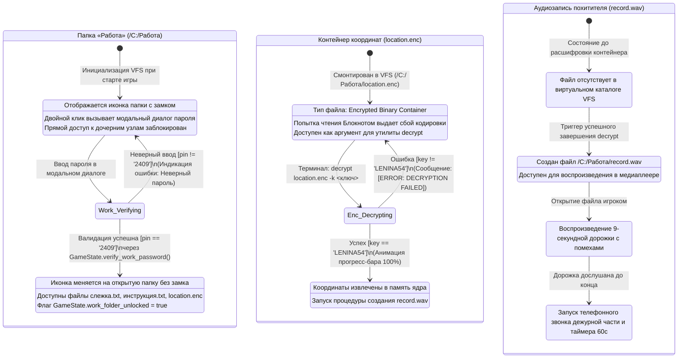

# Спецификация диаграммы состояний (UML State Machine) — Root Access

**Проект:** «Root Access» — детективный ретро-триллер (симулятор ноутбука Panasonic Toughbook CF-27)  
**Документ:** Спецификация автоматов состояний (State Machine Diagrams)  
**Назначение:** Обязательный артефакт 3-й пары по ТРПО (`TZ.md` / `ТРПОПР3.docx`)  
**Версия:** 2.0  
**Дата:** 22.11.2026  
**Автор раздела:** Миша (документовед и QA команды)

---

## 1. Введение и назначение спецификации

Данный документ регламентирует поведение ключевых компонентов детективного симулятора **«Root Access»** с использованием аппарата конечных автоматов в нотации **UML State Machine (Mermaid stateDiagram-v2)**.

В архитектуре игры выделяются три независимых, но тесно взаимодействующих автомата состояний:
1. **Жизненный цикл расследования (`GameState`):** глобальный нарративный автомат прогресса — от начального входа в систему и взлома пароля до дешифрования координат и 5 сюжетных концовок в условиях 60-секундного цейтнота.
2. **Состояния защищённых объектов виртуальной файловой системы (`VFS`):** модель доступа и криптографических состояний для заблокированной папки «Работа», зашифрованного архива `location.enc` и аудиофайла `record.wav`.
3. **Жизненный цикл окна виртуальной ОС (`FARA OS / WindowFrame`):** поведенческая модель оконного менеджера, обрабатывающая фокус ввода, z-индекс, сворачивание в панель задач и закрытие приложений.

---

## 2. Диаграмма 1. Жизненный цикл расследования (GameState)

Диаграмма описывает макро-состояния расследования детектива Ника Будхайма, смену актов сценария и логику перехода к одной из 5 концовок.

```mermaid
stateDiagram-v2
    [*] --> Act1_PasswordSearch: Запуск игры (02:15, дождь)

    state "Акт 1. Поиск пароля к папке «Работа»" as Act1_PasswordSearch {
        [*] --> SearchNotes: Чтение пароли.txt (подсказка: др Юджина)
        SearchNotes --> SearchBrowser: Открытие Истории браузера
        SearchBrowser --> MessengerFound: Переход в чат с Юджином Рейвенсом
        MessengerFound --> GalleryAnalysis: Поиск фото праздника в Галерее
        GalleryAnalysis --> EXIFRead: Чтение даты съёмки 24.09.2009 в свойствах фото
        EXIFRead --> TrashInspection: Обнаружение накладной в Корзине (фура 6752)
        TrashInspection --> PasswordReady: Пароль '2409' вычислен
    }

    state "Акт 2. Взлом «Работы» и анализ карты" as Act2_WorkUnlocked {
        [*] --> FolderAccessible: Доступ к /C:/Работа открыт
        FolderAccessible --> ReadInstructions: Чтение инструкция_шифрование.txt
        ReadInstructions --> InspectMaps: Поиск точки «Адрес Мишель» (LENINA 54)
        InspectMaps --> ReadyToDecrypt: Получение ключа дешифровки 'LENINA54'
    }

    state "Дешифровка location.enc" as DecryptLocation {
        [*] --> RunCLI: Ввод команды decrypt location.enc -k LENINA54
        RunCLI --> ProgressCLI: Прогресс-бар дешифрования [100%]
        ProgressCLI --> DecryptDone: Распаковка аудиофайла record.wav
        DecryptDone --> TimeJump: Перемотка системных часов на 03:40
    }

    state "Акт 3. Аудиоулика и 60-сек кризисный таймер" as Act3_CrisisTimer {
        [*] --> ListenTape: Прослушивание record.wav («Грузовик 6-7-5-2...»)
        ListenTape --> PanicPhoneCall: Тревожный звонок дежурного напарника
        PanicPhoneCall --> TimerCountdown: Старт обратного отсчёта 60 секунд (00:59..00:00)

        state "Модальный шантаж (30-я сек)" as BribeDialog
        state "Ловушка фишинга геометки (Dark UX)" as PhishingTrap

        TimerCountdown --> BribeDialog: timer <= 30.0s [Саймон предлагает $100k]
        BribeDialog --> PhishingTrap: Нажата красная кнопка «Отмена» (задержка 5.0с)
    }

    state "Финальные сюжетные концовки" as Endings {
        state "🟢 Концовка 1. «Герой ночи» (Спасение)" as End1
        state "🔴 Концовка 2. «Роковая ошибка» (Ложный след)" as End2
        state "⚫ Концовка 3. «Опоздание» (Таймаут 00:00)" as End3
        state "🚪 Концовка 4. «Незваный гость» (Хоррор / Выстрел)" as End4
        state "💰 Концовка 5. «Сделка с дьяволом» (Взятка / Wipe)" as End5
    }

    %% Переходы между актами
    Act1_PasswordSearch --> Act2_WorkUnlocked: Ввод пароля в диалоге [pin == '2409']
    Act2_WorkUnlocked --> DecryptLocation: Запуск decrypt в Терминале
    DecryptLocation --> Act3_CrisisTimer: Воспроизведение record.wav завершено

    %% Ветвление концовок
    Act3_CrisisTimer --> End1: Цель: «Склад № 3» + нажата «Отправить спецназ»
    Act3_CrisisTimer --> End2: Выбрана любая неверная точка на карте (Бокс 6752, Свалка и др.)
    Act3_CrisisTimer --> End3: Время истекло [timer == 00:00] до отправки отряда
    PhishingTrap --> End4: Нажата красная кнопка «Продолжить» (слив координат дома)
    BribeDialog --> End5: Ввод команды wipe --force в терминале (согласие на взятку)

    End1 --> [*]
    End2 --> [*]
    End3 --> [*]
    End4 --> [*]
    End5 --> [*]
```



### Краткие пояснения переходов Диаграммы 1:
- `Act1_PasswordSearch -> Act2_WorkUnlocked`: Игрок сопоставляет подсказку из `пароли.txt` («др Юджина») с перепиской в мессенджере и находит снимок у пикапа. Свойства EXIF дают дату `24.09.2009`. Ввод `2409` снимает блокировку с папки «Работа».
- `Act2_WorkUnlocked -> DecryptLocation`: Внутри папки «Работа» открывается `инструкция_шифрование.txt`, указывающая, что ключом является латинский адрес жертвы без пробелов. Поиск на Карте даёт точку «Адрес Мишель» (`LENINA 54`).
- `DecryptLocation -> Act3_CrisisTimer`: Успешный ввод `decrypt location.enc -k LENINA54` завершает дешифровку, перематывает часы на `03:40` и генерирует `record.wav`. Запуск аудиофайла инициирует звонок дежурного и включает 60-секундный таймер.
- `Act3_CrisisTimer -> End1 (Герой ночи)`: Игрок сопоставляет бортовой номер фуры `6752` из фотоархива и накладную из Корзины (`Склад № 3, арендатор Е. Рейвенс`) и отправляет группу захвата на Склад № 3. Заложница спасена.
- `Act3_CrisisTimer -> End2 (Роковая ошибка)`: Игрок поддаётся ловушке внимания и штурмует «Бокс № 6752» или другую точку. Время упущено, маньяк скрывается.
- `Act3_CrisisTimer -> End3 (Опоздание)`: 60 секунд истекают без выбора. В `00:00` все окна принудительно блокируются, наступает критический провал операции.
- `PhishingTrap -> End4 (Незваный гость)`: Под действием паники игрок кликает по красной кнопке «Продолжить» в запутанном окне сертификата безопасности. Домашний адрес Ника передаётся сообщнику Юджину, который вламывается в квартиру.
- `BribeDialog -> End5 (Сделка с дьяволом)`: Игрок поддаётся искушению взяткой $100 000 и вводит `wipe --force` в открывшемся терминале. Улики уничтожены, детектив арестован внутренней безопасностью.

---

## 3. Диаграмма 2. Состояния защищённых объектов VFS

Диаграмма отражает жизненный цикл и криптографические состояния ключевых файловых объектов VFS: папки `/C:/Работа`, архива `location.enc` и аудиозаписи `record.wav`.



### Краткие пояснения переходов Диаграммы 2:
- `Work_Locked -> Work_Unlocked`: Папка «Работа» находится под замком. Переход инициируется нормализованным вводом `2409` (допускаются `24.09`, `24092009`). Снятие блокировки открывает доступ к `location.enc`.
- `Enc_Encrypted -> Enc_Decrypted`: Зашифрованный контейнер невозможно прочитать стандартными системными средствами. Только вызов `decrypt location.enc -k LENINA54` с валидным ключом переводит контейнер в расшифрованное состояние.
- `Rec_Hidden -> Rec_Available -> Rec_Played`: Аудиофайл не существует на диске изначально — он материализуется в VFS только в момент дешифрования. Завершение прослушивания служит триггером перехода глобального состояния в кризисный тайм-аут.

---

## 4. Диаграмма 3. Жизненный цикл окна FARA OS

Диаграмма формализует модель оконного менеджера (`WindowFrame.tscn` / `desktop.gd`), реализующего классический UX десктопных систем конца 90-х годов.

```mermaid
stateDiagram-v2
    [*] --> Closed: Процесс приложения не запущен

    state Closed {
        [*] --> Terminated: Окно уничтожено или не создавалось
        Terminated: Ресурсы сцены Control освобождены
        Terminated: Кнопка на Панели задач отсутствует
    }

    state "Open / Active (Окно открыто и активно)" as Active {
        Active: Заголовок залит градиентом активного окна (#000080)
        Active: Белый текст заголовка, кнопки управления доступны
        Active: Наивысший Z-индекс в дереве Viewport (поверх других окон)
        Active: Окно принимает клавиатурный ввод и события мыши
        Active: Соответствующая кнопка в Панели задач вдавлена (Active)
    }

    state "Inactive (Окно открыто в фоне)" as Inactive {
        Inactive: Серый заголовок неактивного окна (#808080)
        Inactive: Фокус клавиатурного ввода снят
        Inactive: Z-индекс ниже активного окна (может быть перекрыто)
        Inactive: Кнопка на Панели задач поднята (Inactive)
    }

    state "Minimized (Окно свернуто в панель задач)" as Minimized {
        Minimized: Свойство visible = false (окно скрыто с Рабочего стола)
        Minimized: Внутреннее состояние и координаты позиции сохранены в памяти
        Minimized: Кнопка на Панели задач отображается в отжатом виде
    }

    %% Переходы
    Closed --> Active: Двойной клик по ярлыку / Выбор в меню «Пуск»\n[Создание инстанса сцены и добавление в дерево]

    Active --> Inactive: Клик в область другого окна / Открытие модального окна\n[Пересчет Z-индекса, смена стиля заголовка]
    Inactive --> Active: Клик по любой области неактивного окна / Клик по кнопке на Панели задач\n[Вызов move_to_front(), передача фокуса]

    Active --> Minimized: Клик по кнопке «Свернуть» [_] / Клик по активной кнопке в Панели задач\n[Сохранение позиции, visible = false]
    Inactive --> Minimized: Выбор системной команды «Свернуть все окна»

    Minimized --> Active: Клик по кнопке приложения в Панели задач\n[visible = true, move_to_front(), восстановление фокуса]

    Active --> Closed: Клик по кнопке «Закрыть» [X] / Alt+F4 / команда exit в CLI\n[Вызов queue_free(), удаление кнопки с Панели задач]
    Inactive --> Closed: Системный сигнал завершения сессии / аварийное закрытие
```

### Краткие пояснения переходов Диаграммы 3:
- `Closed -> Active`: При запуске создаётся экземпляр сцены приложения, регистрируется элемент в Панели задач, окну присваивается максимальный Z-индекс и фокус ввода.
- `Active <-> Inactive`: Оконный менеджер динамически переключает стиль заголовка (темно-синий для активного, серый для фонового) в зависимости от кликов пользователя по рабочей области.
- `Active / Inactive -> Minimized`: Сворачивание скрывает окно (`visible = false`), освобождая видимое пространство, но полностью сохраняет контекст (позицию скролла, введенный текст в консоли, открытую директорию).
- `Minimized -> Active`: Восстановление возвращает окно на рабочий стол в тех же координатах и мгновенно передает ему приоритет фокуса.
- `Active / Inactive -> Closed`: Закрытие корректно выгружает сцену окна из оперативной памяти (`queue_free()`) и удаляет кнопку приложения из системного трея панели задач.

---

## 5. Матрица триггеров и защитных условий (Guards)

| Исходное состояние | Триггер (Событие) | Guard-условие | Результирующее действие | Новое состояние |
| :--- | :--- | :--- | :--- | :--- |
| `Act1_PasswordSearch` | `submit_password` | `input_pin in ['2409', '24.09', '24092009']` | Разблокировать папку «Работа» | `Act2_WorkUnlocked` |
| `Act2_WorkUnlocked` | `execute_cli_command` | `cmd == 'decrypt location.enc -k LENINA54'` | Старт прогресс-бара дешифровки | `DecryptLocation` |
| `DecryptLocation` | `decrypt_completed` | `progress == 100%` | Создать `record.wav`, часы = `03:40` | `Act3_CrisisTimer` |
| `Act3_CrisisTimer` | `timer_tick` | `time_left <= 30.0 and not bribe_shown` | Открыть модальное окно взятки $100k | `BribeDialog` |
| `BribeDialog` | `button_cancel_pressed` | Нажата красная кнопка «Отмена» | Запустить 5с таймер фишинга | `PhishingTrap` |
| `PhishingTrap` | `button_continue_pressed`| Нажата красная кнопка «Продолжить» | Слить геометку Юджину $\rightarrow$ Выстрел | `End4 (Хоррор)` |
| `BribeDialog` | `execute_wipe_cli` | Введена команда `wipe --force` | Уничтожить диск $\rightarrow$ Взятка | `End5 (Коррупция)` |
| `Act3_CrisisTimer` | `confirm_target` | `target_id == 'warehouse_3'` | Направить спецназ $\rightarrow$ Спасение | `End1 (Герой ночи)` |
| `Act3_CrisisTimer` | `confirm_target` | `target_id != 'warehouse_3'` | Направить спецназ на ложный след | `End2 (Роковая ошибка)` |
| `Act3_CrisisTimer` | `timer_expired` | `time_left == 0.0` | Блокировка всех окон $\rightarrow$ Опоздание | `End3 (Опоздание)` |
| `Window_Active` | `mouse_click_outside` | Клик по другому окну | Понизить Z-индекс, заголовок серый | `Window_Inactive` |
| `Window_Active` | `minimize_button_click`| Клик по кнопке `[_]` | Скрыть фрейм, сохранить позицию | `Window_Minimized` |
| `Window_Minimized` | `taskbar_button_click` | Клик по иконке в Панели задач | Показать фрейм, `move_to_front()` | `Window_Active` |
