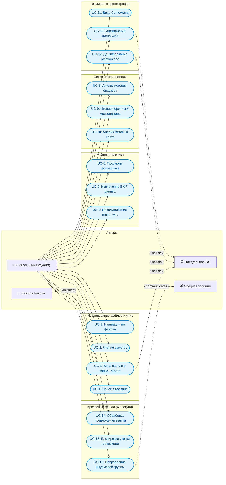

# Спецификация прецедентов использования (Use Case Specification) — Root Access

Данный документ описывает функциональные требования к игровому процессу детективного триллера **«Root Access»** в формате прецедентов использования (Use Cases) в соответствии с нотацией UML.

---

## 1. Акторы системы (Actors)

1. 🕵️‍♂️ **Детектив Ник Будхайм (Игрок)** — главный действующий субъект, проводящий ночной цифровой анализ изъятого ноутбука, сопоставление улик и принятие ключевых тактических решений.
2. 💻 **Виртуальная ОС ноутбука (RetroOS / Toughbook)** — программная среда, обеспечивающая авторизацию, проверку паролей, файловые операции, выполнение терминальных утилит и вывод системных уведомлений.
3. 🔪 **Саймон Раклин (Похититель / Внешняя система)** — антагонист, инициирующий внешние события (предложение взятки $100k, таймер до расправы).
4. 🚔 **Дежурный координатор полиции / Спецназ** — внешняя служба, принимающая целеуказание от детектива и осуществляющая силовой штурм объекта.

---

## 2. Диаграмма прецедентов (Use Case Diagram)

---

## 3. Детальные спецификации ключевых прецедентов

### Прецедент UC-3: Ввод пароля к системной папке «Работа»
* **Цель:** Получить доступ к скрытым материалам слежки и зашифрованному контейнеру.
* **Главный актор:** Игрок.
* **Предусловия:** 
  1. Игрок обнаружил в `пароли.txt` указание: *«др Юджина (день и месяц, 4 цифры: ДДММ)»*.
  2. Игрок сопоставил переписку в мессенджере с фотографией у пикапа и извлёк дату из EXIF: `24.09.2009`.
* **Основной сценарий:**
  1. Игрок дважды кликает на заблокированную директорию `Работа` в Проводнике.
  2. ОС выводит модальное окно авторизации с полем ввода пароля.
  3. Игрок вводит комбинацию символов (допустимы: `2409`, `24.09`, `24092009`).
  4. ОС выполняет валидацию через синглтон `GameState.verify_work_password()`.
  5. Замок снимается, отображается каталог с файлами `мишель_слежка.txt`, `инструкция_шифрование.txt`, `location.enc`.
* **Альтернативный сценарий (3a — Неверный ввод):**
  1. Игрок вводит неверную комбинацию.
  2. Поле ввода подсвечивается красным, выводится предупреждение: *«Неверный пароль»*.
  3. Папка остаётся заблокированной.

---

### Прецедент UC-12: Дешифрование контейнера координат (`decrypt location.enc`)
* **Цель:** Расшифровать бинарные геоданные и извлечь финальную аудиозапись `record.wav`.
* **Главный актор:** Игрок.
* **Предусловия:** 
  1. Игрок открыл `инструкция_шифрование.txt` и узнал синтаксис команды (`decrypt <файл> -k <ключ>`).
  2. Игрок нашёл на Карте точку `Адрес Мишель` с адресом `LENINA 54`.
* **Основной сценарий:**
  1. Игрок запускает терминал.
  2. Игрок вводит команду `decrypt location.enc -k LENINA54`.
  3. Терминал запускает прогресс-бар дешифрования `[████████████████] 100% COMPLETE`.
  4. Виртуальная ОС разблокирует и создает файл `record.wav`.
  5. Системные часы переводятся на `03:40`, срабатывает триггер звонка из дежурной части и запускается 60-секундный таймер.
* **Альтернативный сценарий (2a — Ошибка в синтаксисе или ключе):**
  1. Игрок вводит неверный ключ или имя файла.
  2. Терминал выводит системную ошибку: `[ERROR: DECRYPTION FAILED]`. Контейнер остаётся заблокированным.

---

### Прецедент UC-16: Направление штурмовой группы (Финальный выбор)
* **Цель:** Передать спецназу финальную точку содержания заложницы до истечения таймера.
* **Главный актор:** Игрок.
* **Предусловия:** 
  1. Идёт отсчёт 60-секундного таймера.
  2. На карте доступны интерактивные точки интереса.
* **Основной сценарий:**
  1. Игрок открывает карточку объекта **«Склад № 3»** (опираясь на бортовой номер 6752 фуры из Галереи и накладную из Корзины).
  2. Игрок нажимает кнопку «Отправить группу захвата».
  3. Система подтверждает команду, таймер останавливается.
  4. Запускается **Концовка 1 («Герой ночи»)**: заложница спасена, похититель обезврежен, Ник награждён.
* **Альтернативные сценарии:**
  * **2a (Ошибочная точка):** Игрок выбирает «Бокс № 6752», «Дом Саймона» или «Свалку» $\rightarrow$ Запускается **Концовка 2 («Роковая ошибка»)**.
  * **2b (Таймаут 00:00):** 60 секунд истекают без выбора $\rightarrow$ Запускается **Концовка 3 («Опоздание»)**.
