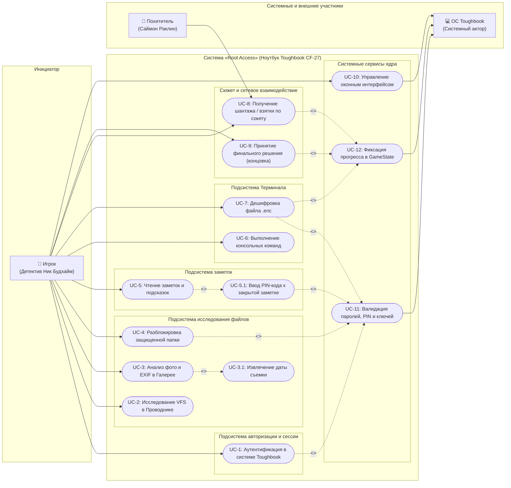
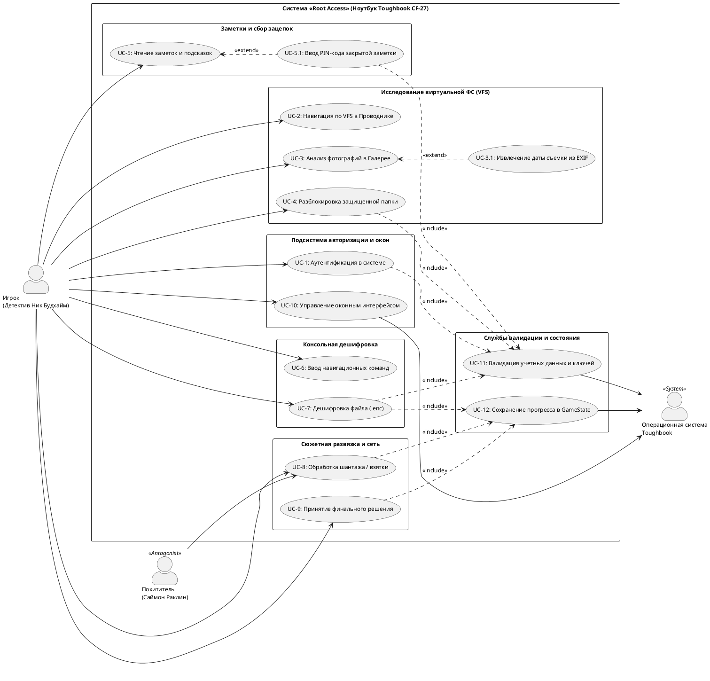

# Модель прецедентов (Use Cases) — Root Access

**Проект:** Root Access — детективный ретро-триллер (симулятор ноутбука Panasonic Toughbook CF-27)  
**Документ:** Спецификация прецедентов и UML-диаграмма вариантов использования  
**Назначение:** Раздел отчета по практической работе ТРПО (ПР-2 / `ТРПОПР2.docx`)  
**Версия:** 1.0  
**Дата:** 22.11.2026  
**Автор раздела:** Миша (документовед и QA команды)

---

## 1. Введение и контекст системы

Программная система «Root Access» представляет собой диегетический детективный симулятор, имитирующий работу операционной системы ноутбука Panasonic Toughbook (рабочее наименование ОС — FARA OS / Toughbook OS). 

Игрок выступает в роли детектива Ника Будхайма, расследующего серию преступлений похитителя Саймона Раклина. Основной игровой цикл строится вокруг исследования виртуальной файловой системы (VFS), сопоставления улик в заметках и свойствах фотографий (EXIF), дешифровки файлов через встроенный терминал, реагирования на провокации похитителя и выхода на одну из сюжетных концовок.

Настоящий документ определяет:
- состав и роли действующих лиц (акторов);
- графическую модель прецедентов в нотации UML;
- спецификацию сценариев использования (предусловия, основные и альтернативные потоки, постусловия).

---

## 2. Акторы системы

В проектируемой системе выделяются три ключевых действующих лица:

| Актор | Тип актора | Описание и роль в игровом процессе |
| :--- | :--- | :--- |
| **Игрок (Детектив Ник Будхайм)** | Основной (Primary Actor, инициатор) | Главный герой расследования. Исследует каталоги VFS, открывает документы и изображения, считывает скрытые метаданные, вычисляет и подбирает пароли, вводит консольные команды в Терминале, реагирует на входящие сетевые угрозы и принимает итоговые сюжетные решения, определяющие финал игры. |
| **Операционная система Toughbook** | Вторичный / Системный (Secondary / System Actor) | Программная среда ноутбука. Выполняет аутентификацию пользователя, осуществляет валидацию паролей, PIN-кодов и криптографических ключей, управляет поведением оконного менеджера, транслирует сетевые сокеты в системные уведомления и обеспечивает надежное сохранение состояния расследования (`GameState`) в `user://save.json`. |
| **Похититель (Саймон Раклин)** | Внешний антагонист (External Actor) | Преступник, контролирующий канал сетевого взаимодействия. Передает через эмулируемые сокеты сообщения с шантажом, угрозами расправы над жертвами, а также предложениями взяток и сделок с целью склонить детектива к сокрытию ключевых улик. |

---

## 3. Диаграмма вариантов использования (Use Case Diagram)

Диаграмма представлена в двух форматах:
1. **Mermaid** — для интерактивного отображения в веб-интерфейсе репозитория и Markdown-редакторах;
2. **PlantUML** — для непосредственного экспорта векторного или растрового изображения в отчет `ТРПОПР2.docx`.

### 3.1. Отображение в нотации Mermaid

### 3.2. Спецификация для PlantUML (для экспорта в Word)

---

## 4. Спецификация основных сценариев использования

### Прецедент UC-1: Аутентификация в системе Toughbook

- **Идентификатор:** UC-1
- **Акторы:** Игрок (Детектив Ник Будхайм), Операционная система Toughbook.
- **Краткое описание:** Вход в рабочую среду ноутбука через экран блокировки FARA OS.
- **Предусловия:**
  1. Приложение запущено.
  2. На экране отображается стартовый экран блокировки Toughbook OS.
- **Основной поток:**
  1. Игрок просматривает экран блокировки с полем ввода пароля учетной записи.
  2. Игрок вводит первичный пароль, найденный во внешних материалах дела.
  3. ОС Toughbook проверяет корректность введенного значения (UC-11).
  4. Пароль подтверждается.
  5. ОС Toughbook инициализирует Рабочий стол и запускает базовые системные службы.
- **Альтернативный поток А1 (Неверный пароль):**
  - На шаге 3 пароль не совпадает с эталонным.
  - ОС Toughbook выводит сообщение: «Неверный пароль. Попробуйте ещё раз.».
  - Поле ввода очищается, фокус возвращается в строку ввода. Система не блокируется.
- **Постусловия:**
  - Рабочий стол FARA OS разблокирован, игроку открыт доступ к ярлыкам Проводника, Галереи, Заметок и Терминала.

---

### Прецедент UC-2: Исследование VFS в Проводнике

- **Идентификатор:** UC-2
- **Акторы:** Игрок (Детектив Ник Будхайм).
- **Краткое описание:** Навигация по виртуальным директориям, переключение режимов просмотра и обнаружение скрытых каталогов маньяка.
- **Предусловия:**
  1. Рабочий стол активен.
  2. Окно Проводника открыто.
- **Основной поток:**
  1. Детектив кликает по каталогам на панели быстрого доступа («Документы», «Изображения», «Загрузки»).
  2. Проводник запрашивает дерево файлов у модуля VFS и отрисовывает содержимое в виде сетки значков.
  3. Детектив открывает меню «Вид» и активирует пункт «Показывать скрытые элементы».
  4. Проводник отображает ранее скрытые системные папки (включая каталог с зашифрованными логами).
- **Альтернативный поток А1 (Попытка открыть неподдерживаемый бинарный файл):**
  - Детектив выполняет двойной клик по поврежденному или нераспознанному файлу.
  - Проводник выводит статус «Просмотр этого типа файлов недоступен» без падения системы.
- **Постусловия:**
  - Детектив получает доступ к структуре папок и выявляет защищенные объекты для последующего анализа.

---

### Прецедент UC-3: Анализ фото и EXIF в Галерее

- **Идентификатор:** UC-3
- **Акторы:** Игрок (Детектив Ник Будхайм).
- **Краткое описание:** Изучение личного фотоархива похитителя, выявление ключевого снимка праздничного торта и извлечение даты съемки из метаданных.
- **Предусловия:**
  1. Проводник или Галерея открыты.
  2. Доступен альбом «День рождения» с фотографиями.
- **Основной поток:**
  1. Детектив открывает приложение «Фотографии» и выбирает альбом «День рождения».
  2. Детектив открывает снимок праздничного торта со свечами «32» в полноэкранном просмотрщике.
  3. Детектив нажимает клавишу `I` (или кнопку «Сведения») для открытия панели метаданных файла.
  4. Система отображает блок EXIF: дата съемки `14.06.2023`, модель камеры `Orion X20`, комментарий «32».
  5. Детектив нажимает кнопку «Копировать дату» и вычисляет год рождения похитителя (`2023 - 32 = 1991`).
- **Постусловия:**
  - В распоряжении детектива появляется строковое значение даты рождения (`14061991` / `14.06.1991`), служащее ключом к закрытому архиву.

---

### Прецедент UC-4: Разблокировка защищенной папки

- **Идентификатор:** UC-4
- **Акторы:** Игрок (Детектив Ник Будхайм), Операционная система Toughbook.
- **Краткое описание:** Открытие зашифрованной папки маньяка с помощью вычисленного пароля.
- **Предусловия:**
  1. В Проводнике обнаружена защищенная папка со значком замка (например, «Архив»).
  2. Детектив вычислил дату рождения из EXIF-метаданных фото.
- **Основной поток:**
  1. Детектив дважды кликает по защищенной папке.
  2. ОС Toughbook отображает модальный диалог ввода пароля.
  3. Детектив вводит значение `14061991` (или нормализованную строку `14.06.1991`).
  4. ОС Toughbook валидирует ввод (UC-11).
  5. Диалог закрывается, значок замка с папки снимается, открывается перечень скрытых файлов архива.
- **Альтернативный поток А1 (Ошибочный ввод):**
  - Детектив вводит неверную комбинацию цифр.
  - Диалог выводит сообщение: «Неверный пароль. Проверьте раскладку и формат.».
  - Папка остается заблокированной.
- **Постусловия:**
  - Папка переходит в статус открытой в `GameState`. Открывается доступ к файлам `.enc`.

---

### Прецедент UC-5: Чтение заметок и ввод PIN-кода

- **Идентификатор:** UC-5
- **Акторы:** Игрок (Детектив Ник Будхайм), Операционная система Toughbook.
- **Краткое описание:** Просмотр текстовых заметок маньяка, разблокировка приватной записи четырехзначным кодом и сбор синтаксиса команд терминала.
- **Предусловия:**
  1. Запущено приложение «Заметки».
- **Основной поток:**
  1. Детектив просматривает левую панель со списком заметок.
  2. Детектив выбирает открытую заметку и изучает текст с BBCode-подсветкой консольных команд (`decrypt <файл> -k <ключ>`).
  3. Детектив выбирает заметку со значком замка («Личные контакты»).
  4. Система запрашивает ввод PIN-кода.
  5. Детектив вводит 4 цифры PIN-кода, найденные в смежных уликах.
  6. ОС Toughbook проверяет PIN-код (UC-11) и открывает текст заметки.
- **Постусловия:**
  - В `GameState` фиксируется прочтение подсказок. Детектив знает синтаксис команды дешифровки и имя зашифрованного файла.

---

### Прецедент UC-6: Выполнение консольных команд в Терминале

- **Идентификатор:** UC-6
- **Акторы:** Игрок (Детектив Ник Будхайм).
- **Краткое описание:** Интерактивное управление файловой системой через интерфейс командной строки FARA OS.
- **Предусловия:**
  1. Окно Терминала открыто и находится в фокусе ввода.
- **Основной поток:**
  1. Детектив вводит команду `help` для ознакомления со списком утилит.
  2. Терминал выводит перечень поддерживаемых команд (`ls`, `cd`, `pwd`, `cat`, `decrypt`, `find`, `clear`).
  3. Детектив выполняет команду `ls -a /home/user/archive` для вывода скрытых файлов.
  4. Терминал возвращает список объектов с цветовым выделением директорий и файлов `.enc`.
  5. Детектив выполняет команду `pwd` для подтверждения виртуального пути.
- **Альтернативный поток А1 (Неизвестная команда):**
  - Детектив вводит произвольную команду, не входящую в белый список.
  - Терминал выводит сообщение: «Команда не найдена. Введите 'help' для справки.».
- **Постусловия:**
  - Детектив находит точный путь к зашифрованному файлу с логами похищений.

---

### Прецедент UC-7: Дешифровка файла (.enc)

- **Идентификатор:** UC-7
- **Акторы:** Игрок (Детектив Ник Будхайм), Операционная система Toughbook.
- **Краткое описание:** Расшифровка защищенного файла с базой данных жертв через консольную утилиту `decrypt`.
- **Предусловия:**
  1. Окно Терминала активно.
  2. Детектив знает путь к файлу (`victims.enc`) и ключ расшифровки.
- **Основной поток:**
  1. Детектив вводит команду вида `decrypt victims.enc -k red_carnation`.
  2. Парсер Терминала выделяет аргументы команды и передает запрос в ядро VFS.
  3. ОС Toughbook производит сверку ключа (UC-11).
  4. ОС Toughbook генерирует расшифрованный файл `victims.txt` в виртуальной ФС.
  5. ОС Toughbook отправляет триггер в `GameState` о регистрации критической улики (UC-12).
  6. Терминал выводит отчет: «Файл успешно расшифрован. Улика добавлена в дело.».
- **Альтернативный поток А1 (Неверный ключ):**
  - Детектив указывает ошибочный ключ дешифрования.
  - Терминал выводит сообщение: «Ошибка дешифрования: неверный ключ доступа.». Файл остается зашифрованным.
- **Постусловия:**
  - В VFS появляется читаемый текстовый документ с координатами логова похитителя, состояние сохраняется в `user://save.json`.

---

### Прецедент UC-8: Обработка шантажа / взятки по сетевому сокету

- **Идентификатор:** UC-8
- **Акторы:** Похититель (Саймон Раклин), Операционная система Toughbook, Игрок (Детектив Ник Будхайм).
- **Краткое описание:** Получение дестабилизирующего входящего сообщения от похитителя с предложением сделки или угрозой.
- **Предусловия:**
  1. В `GameState` зафиксировано определенное количество расшифрованных улик (сюжетный триггер).
- **Основной поток:**
  1. Похититель (Саймон Раклин) инициирует отправку сообщения через виртуальный сетевой сокет.
  2. ОС Toughbook перехватывает сетевой пакет и генерирует модальное системное уведомление на Рабочем столе.
  3. Звучит системный сигнал, на экране отображается окно сообщения от анонимного отправителя:
     - Угроза ликвидации заложника при обращении в полицию;
     - Либо предложение номера оффшорного счета с крупной суммой за форматирование диска.
  4. Детектив изучает полученные условия и решает проигнорировать угрозу либо принять компромат к сведению.
  5. ОС Toughbook регистрирует факт доставки сообщения в `GameState` (UC-12).
- **Постусловия:**
  - В журнале расследования обновляются флаги, влияющие на доступность вариантов финальных концовок.

---

### Прецедент UC-9: Принятие финального решения (выбор концовки)

- **Идентификатор:** UC-9
- **Акторы:** Игрок (Детектив Ник Будхайм), Операционная система Toughbook.
- **Краткое описание:** Выбор одного из альтернативных путей завершения расследования на основе собранных доказательств.
- **Предусловия:**
  1. Собраны основные улики либо истекли ключевые сюжетные триггеры.
  2. На Рабочем столе активирован финальный диалог принятия решения («Отправить досье в архив ФБР» / «Уничтожить улики и принять взятку» / «Выехать на место в одиночку»).
- **Основной поток:**
  1. Детектив выбирает одно из доступных действий в финальном диалоге.
  2. ОС Toughbook опрашивает менеджер `GameState` на предмет наличия необходимых улик.
  3. ОС Toughbook фиксирует выбранный исход:
     - **Концовка 1 (Триумф закона):** Досье передано группе захвата, маньяк задержан, заложник спасен.
     - **Концовка 2 (Сделка с дьяволом):** Детектив форматирует VFS и принимает оффшорный перевод, дело закрывается за неимением улик.
     - **Концовка 3 (Смертельная ловушка):** Недостаточно улик либо совершен ложный шаг — похититель устраивает засаду, детектив погибает.
  4. ОС Toughbook сохраняет финальный статус в `user://save.json` и запускает соответствующую сцену титров.
- **Постусловия:**
  - Игра переходит в состояние завершения с возможностью перезапуска расследования.

---

### Прецедент UC-10: Управление оконным интерфейсом Toughbook OS

- **Идентификатор:** UC-10
- **Акторы:** Игрок (Детектив Ник Будхайм), Операционная система Toughbook.
- **Краткое описание:** Сворачивание, перемещение, закрытие и переключение фокуса окон виртуальной ОС.
- **Предусловия:**
  1. На Рабочем столе открыто хотя бы одно окно приложения.
- **Основной поток:**
  1. Детектив захватывает заголовок окна мышью и перемещает его по рабочей области.
  2. Детектив кликает по кнопке сворачивания — окно скрывается в Панель задач.
  3. Клик по иконке приложения в Панели задач восстанавливает окно с сохранением внутреннего контекста и позиции скролла.
  4. ОС Toughbook обеспечивает корректный Z-индекс (активное окно всегда отображается поверх остальных).
- **Постусловия:**
  - Пользовательский интерфейс сохраняет эргономику и отзывчивость без визуальных артефактов.

---

## 5. Матрица трассировки связей между прецедентами

| Базовый прецедент | Связанный прецедент | Тип отношения | Обоснование |
| :--- | :--- | :--- | :--- |
| **UC-1: Аутентификация** | UC-11: Валидация учетных данных | `<<include>>` | Проверка пароля на экране блокировки является неотъемлемой частью входа. |
| **UC-3: Анализ фото в Галерее** | UC-3.1: Извлечение даты съемки | `<<extend>>` | Просмотр метаданных EXIF и копирование даты вызывается опционально по кнопке/клавише. |
| **UC-4: Разблокировка папки** | UC-11: Валидация учетных данных | `<<include>>` | Снятие замка с каталога невозможно без успешной проверки введенного пароля. |
| **UC-5: Чтение заметок** | UC-5.1: Ввод PIN-кода | `<<extend>>` | Ввод PIN-кода требуется только при открытии закрытых заметок со значком замка. |
| **UC-5.1: Ввод PIN-кода** | UC-11: Валидация учетных данных | `<<include>>` | Проверка 4-значного PIN-кода выполняется централизованной службой ОС. |
| **UC-7: Дешифровка файла .enc** | UC-11: Валидация учетных данных | `<<include>>` | Команда `decrypt` выполняет валидацию криптографического ключа. |
| **UC-7: Дешифровка файла .enc** | UC-12: Сохранение прогресса | `<<include>>` | Успешная дешифровка обязательно фиксирует новую улику в `GameState`. |
| **UC-8: Обработка шантажа** | UC-12: Сохранение прогресса | `<<include>>` | Доставка сетевого сообщения меняет глобальные флаги сюжета. |
| **UC-9: Выбор концовки** | UC-12: Сохранение прогресса | `<<include>>` | Финальное решение детектива записывается в `user://save.json`. |

---

## 6. Рекомендации по оформлению для отчета ТРПОПР2.docx

1. **Диаграмма:**
   - Для экспорта графики в Word рекомендуется скопировать PlantUML-код из раздела 3.2 в [PlantText](https://www.planttext.com/) или использовать плагин PlantUML в VS Code / JetBrains, экспортировав изображение в формате PNG с разрешением не менее 300 DPI.
   - Также доступен экспорт Mermaid-диаграммы из раздела 3.1 через Mermaid Live Editor (`svg` или `png`).
2. **Нумерация сценариев:**
   - Прецеденты пронумерованы сквозным идентификатором `UC-1 ... UC-12`, что позволяет легко ссылаться на них в разделах функциональных требований и тест-кейсов отчета.
3. **Согласованность:**
   - Текстовая спецификация полностью согласована с техническим заданием `docs/TZ.md` и спецификацией требований `docs/SRS.md`.
