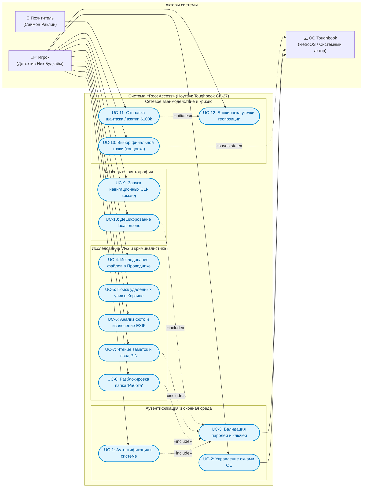
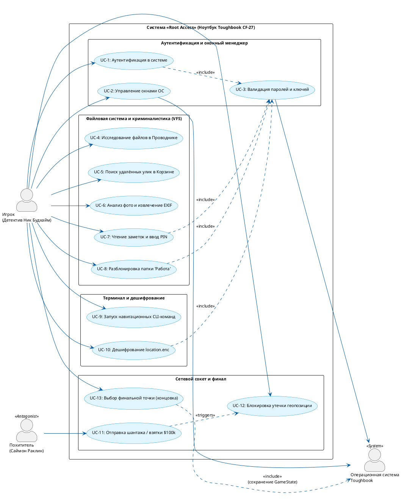

# Спецификация прецедентов использования (Use Case Specification) — Root Access

**Проект:** «Root Access» — детективный ретро-триллер (симулятор ноутбука Panasonic Toughbook CF-27)  
**Документ:** Спецификация прецедентов и UML-диаграмма вариантов использования  
**Назначение:** Раздел отчета по практической работе ТРПО (ПР-2 / `ТРПОПР2.docx`)  
**Версия:** 2.0  
**Дата:** 22.11.2026  
**Автор раздела:** Миша (документовед и QA команды)

---

## 1. Введение и назначение документа

Данный документ описывает функциональные требования к игровому процессу детективного триллера **«Root Access»** в формате прецедентов использования (Use Cases) в соответствии с нотацией UML.

Игрок погружается в роль детектива Ника Будхайма, ведущего ночной анализ изъятого защищенного ноутбука Panasonic Toughbook CF-27 (работающего под управлением виртуальной ретро-системы FARA OS / RetroOS). Ноутбук принадлежал серийному маньяку и похитителю Саймону Раклину. 

Документ предназначен для:
- формализации функционала в отчёте по лабораторной работе №2 (`ТРПОПР2.docx`);
- согласования логики работы модулей интерфейса (Сёма), ядра VFS (Никита) и консольных команд (Женя);
- формирования чек-листов сквозного функционального тестирования (Миша).

---

## 2. Акторы системы (Actors)

В соответствии с архитектурой системы выделяются три ключевых актора:

| Актор | Тип актора | Описание и зоны ответственности |
| :--- | :--- | :--- |
| **Игрок (Детектив Ник Будхайм)** | Основной (Primary Actor, инициатор) | Главный действующий субъект расследования.  • **Исследование файлов:** навигация по VFS в Проводнике, восстановление данных из Корзины, чтение заметок. • **Подбор паролей:** сопоставление записей с EXIF-метаданными фото, разблокировка папки «Работа» и PIN-заметок. • **Запуск команд терминала:** навигация (`ls`, `cd`, `pwd`), чтение (`cat`), дешифрование файлов (`decrypt location.enc -k <ключ>`). • **Выбор финальной точки:** принятие тактических решений в условиях цейтнота, выбор объекта штурма или согласия на сделку, выход на одну из концовок. |
| **Операционная система Toughbook** | Вторичный / Системный (Secondary / System Actor) | Программная среда ретро-ноутбука (FARA OS / RetroOS). • **Аутентификация:** контроль экрана входа, проверка сессионных прав доступа. • **Валидация ключей шифрования:** верификация паролей к директориям и криптографических ключей дешифрования через синглтон `GameState`. • **Управление окнами:** оконный менеджер (перемещение, сворачивание в панель задач, разворачивание, закрытие, Z-индекс, фокус ввода, модальные диалоги). • **Системные службы:** изоляция VFS в песочнице, диспетчеризация сокетов, автосохранение в `user://save.json`. |
| **Похититель (Саймон Раклин)** | Внешний антагонист (External Actor) | Преступник, контролирующий сетевой канал связи. • **Отправка шантажа и предложений взятки:** передача через эмулируемые сетевые сокеты всплывающих модальных окон (`CrisisDialog`) с предложением взятки в $100k за уничтожение улик. • **Дестабилизация расследования:** запуск критического 60-секундного таймера до расправы над заложницей, фишинговые попытки перехвата геопозиции детектива. |

---

## 3. UML-диаграмма прецедентов (Use Case Diagram)

### 3.1. Представление в нотации Mermaid (для Markdown и GitHub)

### 3.2. Спецификация PlantUML (для вставки в отчет `ТРПОПР2.docx`)

---

## 4. Текстовая спецификация основных сценариев использования

Ниже представлена детализированная спецификация ключевых сценариев, отражающая предусловия, основные потоки событий, альтернативные потоки и постусловия для каждого прецедента.

---

### Прецедент UC-1: Аутентификация в системе Toughbook

* **Цель:** Получить доступ к рабочему столу FARA OS ноутбука Toughbook через экран блокировки.
* **Участвующие акторы:** 
  * Игрок (инициатор);
  * ОС Toughbook (валидация учётных данных).
* **Предусловия:**
  1. Приложение «Root Access» запущено на ПК игрока.
  2. Отображается системный экран блокировки с полем ввода пароля учетной записи.
* **Основной поток:**
  1. Игрок изучает экран блокировки (имя учетной записи, аватар, системное время).
  2. Игрок вводит стартовый пароль учетной записи, обнаруженный в оперативных материалах дела.
  3. ОС Toughbook перехватывает ввод и выполняет верификацию хэша пароля (UC-3).
  4. ОС Toughbook подтверждает аутентификацию, скрывает экран блокировки и отображает Рабочий стол с иконками приложений.
* **Альтернативные потоки:**
  * **А1 (Неверный пароль):** Игрок вводит неверную комбинацию. ОС Toughbook выводит сообщение: *«Неверный пароль. Проверьте раскладку клавиатуры»*. Поле ввода очищается, блокировка не накладывается.
* **Постусловия:**
  * Сеанс пользователя активирован. Игроку доступны ярлыки «Проводник», «Фотографии», «Заметки», «Терминал», «Карта».

---

### Прецедент UC-2: Управление окнами операционной системы

* **Цель:** Организовать рабочее пространство для одновременного анализа улик из разных источников (заметки, фото, консоль).
* **Участвующие акторы:**
  * Игрок (инициатор);
  * ОС Toughbook (оконный менеджер).
* **Предусловия:**
  * Рабочий стол разблокирован, открыто как минимум одно окно приложения.
* **Основной поток:**
  1. Игрок зажимает левую кнопку мыши на заголовке окна приложения и перетаскивает его по рабочей области экрана.
  2. ОС Toughbook динамически обновляет координаты окна, ограничивая его перемещение границами экрана (заголовок не может уйти за край).
  3. Игрок кликает по заголовку фонового окна — ОС Toughbook поднимает его Z-индекс на передний план и передает фокус ввода.
  4. Игрок нажимает кнопку «Свернуть» — ОС Toughbook скрывает окно и активирует соответствующий индикатор на Панели задач.
  5. Повторный клик по кнопке на Панели задач восстанавливает окно в прежних координатах с сохранением внутреннего состояния.
* **Альтернативные потоки:**
  * **А1 (Модальный диалог):** При открытии модального диалога ввода пароля (UC-8) или кризисного окна (UC-11) ОС Toughbook блокирует взаимодействие с родительским окном до закрытия диалога.
* **Постусловия:**
  * Положение, размеры и порядок наложения окон соответствуют действиям игрока.

---

### Прецедент UC-3: Валидация паролей и ключей шифрования

* **Цель:** Централизованно проверить введённый пароль, PIN-код или ключ дешифрования на соответствие эталону.
* **Участвующие акторы:**
  * ОС Toughbook (исполнитель сервиса валидации);
  * Игрок (поставщик входных данных).
* **Предусловия:**
  * Инициирован один из прецедентов, требующих проверки подлинности (UC-1, UC-7, UC-8, UC-10).
* **Основной поток:**
  1. ОС Toughbook получает строковый аргумент (пароль, PIN или ключ) и идентификатор целевого объекта.
  2. Служба валидации выполняет нормализацию строки (удаление лишних пробелов, приведение регистра для нечувствительных полей).
  3. Вызывается проверка через менеджер состояния `GameState` (например, `GameState.verify_work_password()`).
  4. Значение признается корректным, ОС Toughbook генерирует сигнал подтверждения `access_granted`.
* **Альтернативные потоки:**
  * **А1 (Несоответствие ключа):** Значение не совпадает с эталоном. Генерируется сигнал `access_denied`, объект остаётся заблокированным.
* **Постусловия:**
  * Вызывающий компонент получает булев результат проверки для выполнения дальнейших действий.

---

### Прецедент UC-4: Исследование файлов в Проводнике

* **Цель:** Изучить файловую структуру виртуального диска маньяка, выявить скрытые папки и документы со следами преступлений.
* **Участвующие акторы:**
  * Игрок.
* **Предусловия:**
  * Рабочий стол активен, запущено приложение «Проводник».
* **Основной поток:**
  1. Игрок кликает по каталогам на боковой панели («Документы», «Изображения», «Загрузки»).
  2. Проводник отправляет запрос ядру VFS и отображает список файлов и подпапок.
  3. Игрок переходит в меню «Вид» и включает опцию «Показывать скрытые элементы».
  4. Проводник отрисовывает скрытые файлы с полупрозрачными иконками (включая каталог системных логов).
  5. Игрок выполняет двойной клик по поддерживаемому файлу — система открывает его во встроенном просмотрщике.
* **Альтернативные потоки:**
  * **А1 (Неподдерживаемый файл):** При двойном клике по неизвестному бинарному файлу Проводник выводит статус *«Просмотр этого типа файлов недоступен»*, окно не зависает.
* **Постусловия:**
  * Игрок получает представление о расположении улик и защищенных объектов на диске.

---

### Прецедент UC-5: Поиск удалённых улик в Корзине

* **Цель:** Найти черновики документов и транспортные накладные, выброшенные похитителем для сокрытия следов.
* **Участвующие акторы:**
  * Игрок.
* **Предусловия:**
  * Игрок открыл системную папку «Корзина» на Рабочем столе или в Проводнике.
* **Основной поток:**
  1. Игрок просматривает список удалённых файлов в окне Корзины.
  2. Игрок обнаруживает файл транспортной накладной `накладная_склад3.txt`.
  3. Игрок открывает файл и извлекает информацию о доставке грузов на «Склад № 3» и номере прицепа `6752`.
  4. Нажатием кнопки «Восстановить» игрок возвращает файл в каталог документов для постоянного доступа.
* **Альтернативные потоки:**
  * **А1 (Попытка очистки):** При попытке очистить корзину система блокирует удаление файлов с пометкой *«Критический файл расследования защищен от уничтожения»*.
* **Постусловия:**
  * Восстановленная накладная зарегистрирована в `GameState` как улика, связывающая номер 6752 с локацией «Склад № 3».

---

### Прецедент UC-6: Анализ фотоархива и извлечение EXIF-метаданных

* **Цель:** Найти визуальные и технические зацепки на фотографиях похитителя для вычисления паролей.
* **Участвующие акторы:**
  * Игрок.
* **Предусловия:**
  * Запущено приложение «Фотографии» (Галерея), открыт фотоархив.
* **Основной поток:**
  1. Игрок просматривает сетку миниатюр и открывает фотографию праздничного торта со свечами «32» (альбом «День рождения»).
  2. В полноэкранном просмотрщике игрок нажимает кнопку «Сведения» (клавиша `I`).
  3. ОС Toughbook открывает панель метаданных: дата съёмки `14.06.2023`, модель камеры `Orion X20`, комментарий «32».
  4. Игрок сопоставляет возраст 32 года на торте и дату снимка 2023 года, вычисляя дату рождения: `14.06.1991`.
  5. Игрок нажимает кнопку «Копировать дату» — значение `14.06.1991` помещается в буфер обмена.
* **Постусловия:**
  * Игрок получает точную дату рождения похитителя, являющуюся паролем к заблокированной папке «Работа».

---

### Прецедент UC-7: Чтение заметок и подбор PIN-кода

* **Цель:** Изучить черновики похитителя, разблокировать защищённую заметку и найти синтаксис консольных команд.
* **Участвующие акторы:**
  * Игрок (инициатор);
  * ОС Toughbook (валидация PIN).
* **Предусловия:**
  * Запущено приложение «Заметки».
* **Основной поток:**
  1. Игрок просматривает список заметок в левой панели.
  2. В открытой заметке «Инструкция по шифрованию» игрок считывает синтаксис утилиты `decrypt <файл> -k <ключ>`.
  3. Игрок кликает по заметке со значком замка «Скрытые контакты».
  4. ОС Toughbook отображает поле ввода цифрового PIN-кода.
  5. Игрок вводит 4-значный PIN-код, вычисленный из накладных.
  6. ОС Toughbook валидирует ввод (UC-3) и открывает защищенный текст заметки.
* **Альтернативные потоки:**
  * **А1 (Неверный PIN):** Поле подсвечивается красным, текст остается заблокированным.
* **Постусловия:**
  * В `GameState` отмечается флаг изучения синтаксиса терминала и доступа к скрытым контактам.

---

### Прецедент UC-8: Подбор пароля и разблокировка папки «Работа»

* **Цель:** Снять блокировку с критической папки «Работа», содержащей зашифрованные координаты жертвы.
* **Участвующие акторы:**
  * Игрок (ввод пароля);
  * ОС Toughbook (проверка пароля и снятие блокировки).
* **Предусловия:**
  * Папка «Работа» отображается в Проводнике со значком замка.
  * Игрок вычислил пароль-дату из EXIF-метаданных фото (UC-6) или файла `пароли.txt`.
* **Основной поток:**
  1. Игрок дважды кликает по папке «Работа».
  2. ОС Toughbook выводит модальный диалог авторизации с полем ввода пароля.
  3. Игрок вводит строку `14061991` (или `2409` в зависимости от ветки сценария).
  4. ОС Toughbook проверяет пароль через `GameState.verify_work_password()` (UC-3).
  5. Замок снимается, каталог открывается; внутри отображаются файлы `мишель_слежка.txt` и `location.enc`.
* **Альтернативные потоки:**
  * **А1 (Ошибочный пароль):** Диалог сообщает *«Неверный пароль. Проверьте дату»*. Папка остаётся заблокированной.
* **Постусловия:**
  * Папка «Работа» переходит в открытый статус, зашифрованный файл `location.enc` становится доступен для консоли.

---

### Прецедент UC-9: Запуск навигационных CLI-команд в Терминале

* **Цель:** Исследовать файловые пути и скрытые каталоги VFS через командную строку.
* **Участвующие акторы:**
  * Игрок.
* **Предусловия:**
  * Окно Терминала открыто и сфокусировано.
* **Основной поток:**
  1. Игрок вводит команду `help` и просматривает список зарегистрированных утилит.
  2. Игрок вводит команду `pwd` — терминал выводит текущую виртуальную директорию `/home/user`.
  3. Игрок выполняет `cd /home/user/Work` и затем `ls -a`.
  4. Терминал выводит список файлов, подсвечивая директории синим, а зашифрованные файлы `.enc` — желтым цветом.
  5. Игрок читает содержимое текстового файла командой `cat note.txt`.
* **Альтернативные потоки:**
  * **А1 (Неизвестная команда):** Терминал выводит *«Команда не распознана. Введите help для справки»*.
  * **А2 (Попытка cat бинарного/зашифрованного файла):** Терминал сообщает *«Файл зашифрован. Используйте утилиту decrypt»*.
* **Постусловия:**
  * Игрок определяет точное имя и путь целевого криптографического контейнера `location.enc`.

---

### Прецедент UC-10: Дешифрование файла `location.enc`

* **Цель:** Расшифровать бинарные геоданные похитителя и извлечь финальную аудиозапись `record.wav`.
* **Участвующие акторы:**
  * Игрок (ввод команды);
  * ОС Toughbook (валидация ключа и генерация расшифрованного файла).
* **Предусловия:**
  * Игрок знает синтаксис команды дешифрования (UC-7).
  * Игрок вычислил ключ дешифрования из адреса на карте (`LENINA54` или `red_carnation`).
* **Основной поток:**
  1. Игрок вводит в терминале команду: `decrypt location.enc -k LENINA54`.
  2. Терминал запускает ретро-анимацию прогресс-бара дешифрования: `[████████████████] 100% COMPLETE`.
  3. ОС Toughbook валидирует ключ шифрования (UC-3).
  4. ОС Toughbook создаёт в VFS расшифрованный аудиофайл `record.wav` и текстовые координаты.
  5. Системные часы переводятся на ночное время кризиса (`03:40`), срабатывает сюжетный триггер и запускается 60-секундный таймер финала.
* **Альтернативные потоки:**
  * **А1 (Неверный ключ):** Терминал выводит *«[ERROR: DECRYPTION FAILED] Неверный ключ»*. Файл не расшифровывается.
* **Постусловия:**
  * Улика расшифрована, в `GameState` активирован режим кризисного финала (Crisis Mode).

---

### Прецедент UC-11: Отправка шантажа и предложения взятки через сетевой сокет

* **Цель:** Оказать психологическое давление на детектива, предложить сделку или спровоцировать ошибку.
* **Участвующие акторы:**
  * Похититель Саймон Раклин (инициатор);
  * ОС Toughbook (доставка через сокет и вывод модального диалога);
  * Игрок (получатель).
* **Предусловия:**
  * Игрок успешно расшифровал `location.enc` (UC-10) — сработал триггер финала.
* **Основной поток:**
  1. Похититель (Саймон Раклин) отправляет сетевой пакет по сокету ноутбука.
  2. ОС Toughbook перехватывает входящее событие и разворачивает поверх всех окон модальный ретро-диалог `CrisisDialog`.
  3. Звучит резкий системный зуммер, на экране отображается шантаж:
     * Таймер обратного отсчета (60 секунд до гибели заложницы);
     * Предложение взятки в $100 000 на оффшорный счет взамен на запуск утилиты очистки диска `wipe`;
     * Фишинговый запрос разрешения на отправку геопозиции ноутбука детектива.
* **Постусловия:**
  * Игрок поставлен в жесткие временные рамки для принятия финального решения.

---

### Прецедент UC-12: Блокировка утечки геопозиции

* **Цель:** Предотвратить вычисление местоположения детектива похитителем при сетевой фишинговой атаке.
* **Участвующие акторы:**
  * Игрок;
  * ОС Toughbook.
* **Предусловия:**
  * На экране активно модальное окно кризисного сетевого запроса от Саймона Раклина.
* **Основной поток:**
  1. Игрок замечает скрытый переключатель «Разрешить передачу телеметрии и координат хоста» в модальном окне.
  2. Игрок своевременно снимает чекбокс (или нажимает «Блокировать сетевой пакет»).
  3. ОС Toughbook разрывает виртуальный сокет и блокирует передачу данных наружу.
* **Альтернативные потоки:**
  * **А1 (Игрок проигнорировал переключатель):** Геопозиция детектива утекает к преступнику $\rightarrow$ активируется триггер плохой концовки (засада на детектива).
* **Постусловия:**
  * Похититель не получает координат детектива; сохраняется шанс на успешный штурм.

---

### Прецедент UC-13: Выбор финальной точки и завершение расследования

* **Цель:** Направить спецназ на верный объект содержания заложницы либо совершить фатальный выбор.
* **Участвующие акторы:**
  * Игрок (принятие решения);
  * ОС Toughbook (фиксация в `GameState`, запуск сцены концовки, сохранение в `user://save.json`).
* **Предусловия:**
  * Идет обратный отсчет 60-секундного таймера.
  * На интерактивной карте города открыты карточки объектов интереса.
* **Основной поток (Концовка 1 — «Герой ночи»):**
  1. Игрок сопоставляет бортовой номер фуры `6752` из фотоархива (UC-6) и накладную из Корзины (UC-5).
  2. Игрок открывает карточку объекта **«Склад № 3»** на Карте.
  3. Игрок нажимает кнопку «Отправить группу захвата».
  4. ОС Toughbook останавливает таймер, фиксирует победный флаг в `GameState` и сериализует сохранение в `user://save.json`.
  5. Запускается победная концовка: спецназ берет склад штурмом, заложница спасена, Саймон Раклин арестован.
* **Альтернативные потоки (Ветвление концовок):**
  * **А1 (Концовка 2 — «Роковая ошибка»):** Игрок выбирает ложный объект («Бокс № 6752» или «Дом Саймона»). Спецназ штурмует пустой склад, похититель успевает скрыться с жертвой.
  * **А2 (Концовка 3 — «Опоздание»):** Истекают 60 секунд таймера без отправки группы. Время упущено, связь обрывается.
  * **А3 (Концовка 4 — «Сделка с дьяволом»):** Игрок соглашается на взятку Саймона Раклина в $100k и запускает команду `wipe` в терминале. Улики уничтожены, детектив берет деньги, расследование саботировано.
  * **А4 (Концовка 5 — «Ужас во тьме»):** Детектив допустил утечку координат (UC-12) и выехал на место в одиночку. Похититель устраивает засаду на детектива.
* **Постусловия:**
  * Игра завершается демонстрацией сюжетного эпилога выбранной концовки. Результат сохраняется в `user://save.json`.

---

## 5. Матрица трассировки связей между прецедентами

| Базовый прецедент | Связанный прецедент | Отношение | Обоснование |
| :--- | :--- | :--- | :--- |
| **UC-1: Аутентификация** | UC-3: Валидация паролей | `<<include>>` | Вход в ОС невозможен без сверки введенного пароля. |
| **UC-7: Чтение заметок** | UC-3: Валидация паролей | `<<include>>` | Открытие защищённых PIN-заметок требует валидации 4-значного кода. |
| **UC-8: Разблокировка папки** | UC-3: Валидация паролей | `<<include>>` | Снятие блокировки с директории «Работа» требует проверки даты-пароля. |
| **UC-10: Дешифрование файла** | UC-3: Валидация паролей | `<<include>>` | Утилита `decrypt` обращается к сервису валидации ключа `GameState`. |
| **UC-11: Отправка шантажа** | UC-12: Блокировка утечки | `<<triggers>>` | Входящее сетевое сообщение инициирует угрозу компрометации геопозиции. |
| **UC-13: Выбор концовки** | ОС Toughbook (`user://save.json`) | `<<include>>` | Финал расследования обязательно персистируется в локальный файл сохранений. |

---

## 6. Рекомендации по оформлению отчета ТРПОПР2.docx

1. **Экспорт диаграммы в Word:**
   * **Вариант 1 (PlantUML):** Скопировать блок кода из **раздела 3.2** на сайт [PlantText.com](https://www.planttext.com/) или скомпилировать через плагин IDE в PNG с высоким разрешением (не менее 300 DPI) для четкой печати в Word.
   * **Вариант 2 (Mermaid):** Вставить блок кода из **раздела 3.1** в [Mermaid Live Editor](https://mermaid.live/) и скачать изображение в векторном формате SVG либо PNG.
2. **Нумерация прецедентов:**
   * Идентификаторы `UC-1 ... UC-13` унифицированы со сквозными требованиями `docs/SRS.md` и календарным планом `docs/TZ.md`.
3. **Соответствие критериям ТРПО:**
   * В диаграмме и спецификации явно выделены границы проектируемой программной системы (ноутбук Toughbook), три обязательных актора (Игрок, ОС Toughbook, Похититель Саймон Раклин) и специфицированы предусловия, основной поток и постусловия каждого сценария.
